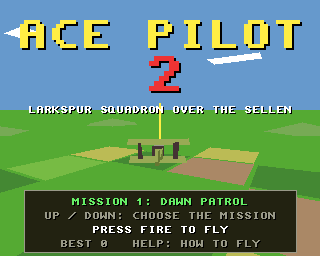
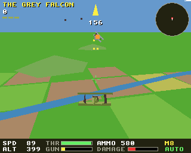
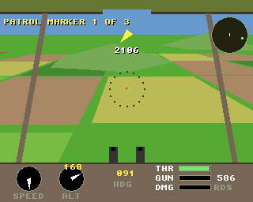

# Ace Pilot 2

A biplane war in 3D for the classic Amiga (68020 to 68060, OS 3.0+) and
AmigaOS 4.1 on PowerPC, from one source on the shared
[`amiga3d`](../amiga3d/README.md) engine. The sequel to the 2D
[`ace_pilot`](../ace_pilot/), and the game that one wanted to be.

You fly a Swallow scout of Larkspur Squadron against the Grauland air
service, over the trenches and the river Sellen. Fly it from behind (the
chase view) or from the cockpit, with its upper wing overhead, its struts,
the twin guns on the cowling and their ring sight.





## The missions

1. **Dawn Patrol**: fly the patrol line over the trenches, three markers
   west to east. Wasps come for you after the first.
2. **Eyes in the Sky**: burn two observation balloons behind the river,
   past their anti-aircraft guns.
3. **Shepherd**: escort two Heron two-seaters to photograph the depot at
   Orme and back. Bring at least one home.
4. **Iron Road**: stop the supply train on the Kessin railway (the engine
   and wagons, three in all) before it gets to the east. One wagon carries
   a gun; Hornets patrol the line.
5. **Hold the Line**: four Ox bombers, a Hornet with them, are coming for
   our reserve depot. Shoot all four down; if two get through, the depot
   is lost. Their rear gunners cover the tail and sides.
6. **Supply Lines**: destroy the four supply dumps at Orme. Lorries run
   on the road to the front.
7. **Hornets' Nest**: raid the aerodrome at Kessin, far behind the lines:
   three hangars, three guns, and a Hornet that takes off when a hangar
   burns.
8. **The Grey Falcon**: their ace and his two wingmen. The wingmen
   circle above and leave him to it, until you hurt him.

Each mission ends back over Larkspur Field. You have three aeroplanes:
lose one (shot down, or into the ground) and you fly the mission again;
lose all three and the squadron grounds you. The briefing shows a map of
the sector and your record; rank goes by score, from Second Lieutenant to
Wing Commander.

## Flying

- **Bank to turn.** Left and right roll the aeroplane; let go and the
  wings level by themselves. Pull back in a bank to turn harder; in a
  steep bank the nose drops unless you pull.
- **Energy.** Full throttle holds about 90 units a second level.
  Climbing costs speed and diving buys it: hold a climb too steep and you
  slow to a **stall**, when the nose drops whatever you do and the wings
  rock. Below flying speed the aeroplane sinks.
- **The guns** fire both barrels together, and heat up: fire in bursts or
  they jam for three seconds. 600 rounds.
- **Landing**: come down gently (wings level, nose about level, slowly) on
  flat ground. Stop on Larkspur Field's strip and you are rearmed and
  repaired; open the throttle and pull back to take off. Anything harder
  is a crash.
- Anti-aircraft guns find it hard to lay on a low aeroplane.
- Wasps are light and quick, Hornets tougher, Ox bombers slow with a rear
  gunner, and the Grey Falcon is better than all of them.

The HUD shows the objective and an arrow to it, the score and your
aeroplanes, a radar (turned with you: red theirs, blue ours, yellow the
target, green home), where your guns point, and the speed, height,
throttle, gun heat, ammunition and damage. The cockpit has the same on
its panel.

## Controls

| | |
|---|---|
| Left / right (joystick) | bank |
| Up / down (joystick) | nose down / nose up (I inverts) |
| Space / fire | guns |
| A / Z | throttle up / down |
| V (or C) | chase view / cockpit |
| I | invert up and down |
| P | pause |
| B | autopilot on / off |
| Help / H | how to fly, the controls |
| Esc | back to the title, or quit from it |

On the title, up and down choose the mission to start from.

## Building

```sh
scripts/build-example-68k.sh ace_pilot2   # ace_pilot2, ace_pilot2_test
scripts/build-example-ppc.sh ace_pilot2   # ace_pilot2_os4
make -C examples/ace_pilot2 host-test     # the tests on the host
make -C examples/ace_pilot2 ubsan         # the same under UBSan and ASan
make -C examples/ace_pilot2 vectors       # regenerate tests/vectors.h
```

No data files: the effects are synthesised at start-up and there is no
music, so the binary is all you need.

## How it works

- `ap.h`, `ap_core.c`: the whole war in 16.16 fixed point with no Amiga
  headers. Every aeroplane flies the same model (`ap_fly`): thrust
  against drag times speed squared and gravity along the flight path; roll
  from the stick, yaw from the bank, pitch from the stick split between
  pitch and yaw by the bank; the nose dropping in a bank; a stall and a
  sink below flying speed; the ground (a landing or a crash). The
  computer's pilots fly it through the same controls the player has
  (`ap_steer`): bank towards the heading wanted, pull to turn tighter,
  climb or dive towards the height wanted, keep off the ground.
- The enemy fighters patrol, pursue the nearest of ours (aiming ahead of
  it), fire in bursts when it is on the nose, break away when it is on
  their tail or too close (head on: over the top), climb when low, and run
  for home when badly hit (the Falcon never does). Herons and Oxen fly
  routes; the Oxen's gunners cover the tail and sides.
- Bullets are swept against aeroplanes and ground targets each tick. The
  anti-aircraft guns fire shells with a fuse at where you will be, with an
  error that grows with range and as you get lower.
- The autopilot (`ap_bot`) flies the missions: dogfights with lead,
  strafing runs (line up from height, dive, fire, climb away, extend and
  come round again, the guns round a target first), the patrol markers,
  keeping with the Herons, home. It flies the title's demo.
- `render.c`: the camera banks with the aeroplane: a roll of camera space
  after `cam_xform`, as in orbit_docking. The engine's `a3d_model` doesn't
  roll, so models are drawn by a copy of it that does. The camera is
  placed to a sixteenth of a unit (`cam_place`) and each model drawn from
  its own 16.16 position (`cam_for`), so the chase view doesn't judder.
  The sky is the copper gradient; the earth below the horizon is one
  polygon tilted with the bank; then the patchwork of fields round the
  camera, the river, the railway, no-man's-land and the trenches, the
  road, the aerodromes; then hills, buildings, the train and lorries,
  balloons, aeroplanes (three levels of detail), tracer, shell bursts,
  smoke, explosions and clouds. The view reaches 1600 units on the 68k
  and 3200 on AmigaOS 4.
- `game.c`: input, sound, the title, the briefing, the result, the end of
  the campaign, smoke and explosions, and the bridge.

## Testing

`tests/test_cases.c` runs on the host, as `ace_pilot2_test` on the Amiga,
and inside the game (the `selftest` hook): the map, the missions'
set-ups, the flight model (cruise, throttle, climbing and diving, bank to
turn, the stall and its recovery, a crash, landing, rearming, taking off,
a banked touchdown), the guns (firing, heat and the jam, running dry),
hits and kills, a miss, a strafing run, enemy fire, the AA guns (and
flying under them), the enemy pilots (attacking, fleeing), the train
(running, stopped when its engine goes), the mission flow and the
campaign, and the autopilot flying all eight missions. Finally a long
autopilot campaign (20000 ticks) whose state hash must match the host's
(`tests/vectors.h`), so the Amiga flies exactly the same war.

`tests/e2e_devbench.py` drives the running game through devbench: the
self-test, the title and the briefing with injected keys, the throttle,
the stick, the bank and the guns with keys, the cockpit view, a practice
Wasp shot down (the `spawn` hook), a dogfight, the autopilot flying the
dawn patrol to its result, a crash losing an aeroplane, the help pages,
timings, Esc and stopping.

```sh
python3 tests/e2e_devbench.py --url http://localhost:3001/mcp --no-build   # classic Amiga, deployed already
python3 tests/e2e_devbench.py --os4 local --url http://localhost:3010/mcp --launch RAM:ace_pilot2
```

Results on 2026-10-31: 65/65 host tests (also under UBSan and ASan), the
same 65 inside the game on both Amigas with the campaign's hash matching
(6.2 s on FS-UAE's A1200, 1.9 s under QEMU). End to end, 32/32 on FS-UAE
(25 fps, 26 to 76 polygons a frame) and 31/32 on AmigaOS 4.1 under QEMU
(25 fps): there `amiga_stop_client` left the game running (Esc quits it).

The autopilot completes every mission on the host from seed 1 (the tests
check that); over six seeds it completes every mission every
time except mission 6 and mission 8, five times each.

## Bridge

- vars (32, the bridge's limit): `score mission phase state lives kills
  gkills shots hits hp ammo heat jam x y z yaw pitch roll speed throttle
  stalled view autoplay start_mission paused help enemies fps polys
  us_update us_draw`
- hooks: `status`, `start [mission]` (straight into the air), `title`,
  `autoplay on|off`, `spawn wasp|hornet|ox|falcon [DIST]` (a lone practice
  target flying straight ahead, its gun silent), `clear` (the objectives
  done), `hp N`, `seed N`, `help N`, `pause on|off`, `view chase|cockpit`,
  `next` (on from the briefing or a result), `selftest`, `activate`
