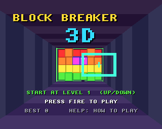
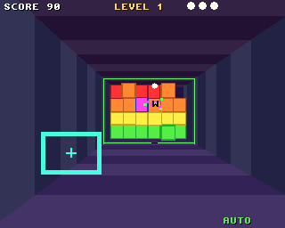

# Block Breaker 3D

Breakout played down a tunnel, for the classic Amiga (68020 to 68060,
OS 3.0+) and AmigaOS 4.1 on PowerPC, from one source on the shared
[`amiga3d`](../amiga3d/README.md) engine.

The paddle is a frame across the tunnel's near opening that moves up,
down, left and right. The ball flies down the tunnel to a block of bricks
at the far end (6 across, 4 high, 3 deep) and back again. Where the ball
meets the paddle steers it. A green ring round the tunnel walls and a
shadow on the floor show how far away the ball is.




## The game

- 8 levels: First Light, Chequers, The Window, Pillars, Stairway, The
  Vault, Crossfire and The Core.
- Coloured bricks break in one hit. Silver bricks take 2 hits (3 from
  level 5), and steel never breaks.
- Pink bricks drop a capsule that drifts towards you; catch it
  with the paddle: **W** wider paddle, **S** slower ball, **L** an extra
  life, **P** the ball ploughs straight through bricks for a while.
- The ball speeds up the longer a rally lasts.
- Scoring: 10 a brick, 30 a tough one, 50 a bonus one, +5 for each layer
  deeper; 100 a capsule; 250 x the level for clearing it.
- An autopilot (B) plays on its own; it also plays the demo behind the
  title.

## Controls

| | |
|---|---|
| Arrows / WASD / joystick | move the paddle |
| Space / fire | serve |
| P | pause |
| B | autopilot on / off |
| Help / H | the rules and controls |
| Esc | back to the title, or quit from it |

## Building

```sh
scripts/build-example-68k.sh block_breaker_3d   # block_breaker_3d, block_breaker_3d_test
scripts/build-example-ppc.sh block_breaker_3d   # block_breaker_3d_os4
make -C examples/block_breaker_3d host-test     # the tests on the host
make -C examples/block_breaker_3d ubsan         # the same under UBSan and ASan
make -C examples/block_breaker_3d vectors       # regenerate tests/vectors.h
```

No data files: the effects are synthesised at start-up and there is no
music, so the binary is all you need.

## How it works

- `bb.h`, `bb_core.c`: the rules, in integers (1/256 units), with no Amiga
  headers. The ball moves a quarter of a tick at a time and one axis at a
  time. If a move along an axis takes it into a brick, that move is undone
  and that axis' speed reversed, which gives clean bounces off faces and
  never leaves the ball inside a brick.
- `render.c`: the tunnel (striped along its length), only the brick faces
  you can see (the front, plus the sides and tops that face the camera
  with no brick against them), the ball, its ring and shadow, capsules,
  broken-brick bits and the paddle. The camera leans a little with the
  paddle.
- `game.c`: input, sound, the title, game over and the bridge.

## Testing

`tests/test_cases.c` runs on the host, as `block_breaker_3d_test` on the
Amiga, and inside the game (the `selftest` hook). It covers walls, the
paddle and steering, misses, tough and steel bricks, the plough, capsules,
the level flow and winning. It also checks the autopilot clearing levels
1 and 3 without the ball ever leaving the tunnel or ending up inside a
brick. Finally it plays a 20,000-tick autopilot game and checks the state
hash against the host's (`tests/vectors.h`), so the Amiga must play
exactly the same game.

`tests/e2e_devbench.py` drives the running game through devbench: the
self-test, the title, the paddle and serve with injected keys, an
autopilot rally, a capsule, clearing a level, the memory region, game
over, the help pages, timings and stopping.

```sh
python3 tests/e2e_devbench.py --url http://localhost:3001/mcp           # classic Amiga (builds and deploys)
python3 tests/e2e_devbench.py --os4 local --url http://localhost:3000/mcp --launch RAM:block_breaker_3d
python3 tests/e2e_devbench.py --url http://localhost:13001/mcp --remote chris@spark.local --no-build
```

Results on 2026-10-30: 42/42 host tests (also under UBSan and ASan);
24/24 end-to-end on FS-UAE (68020, 25 fps, 28 ms to draw a frame on the
busiest level) and on AmigaOS 4.1 under QEMU (25 fps, 2.6 ms a frame).

## Bridge

- vars: `score level lives left state over won autoplay paddle_x paddle_y
  ball_x ball_y ball_z speed broken paddle_hits stuck wide start_level
  paused help fps polys us_update us_draw`
- hooks: `status`, `start [level]`, `title`, `autoplay on|off`, `serve`,
  `clear`, `paddle X Y`, `capsule wide|slow|life|plough`, `lives N`,
  `seed N`, `help N`, `pause on|off`, `selftest`, `activate`
- memory: `cells` (72 bytes: `[layer][row][col]`, layer 0 nearest)
