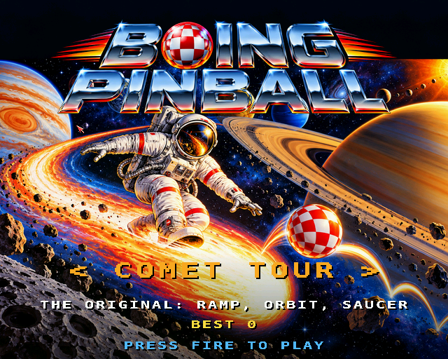
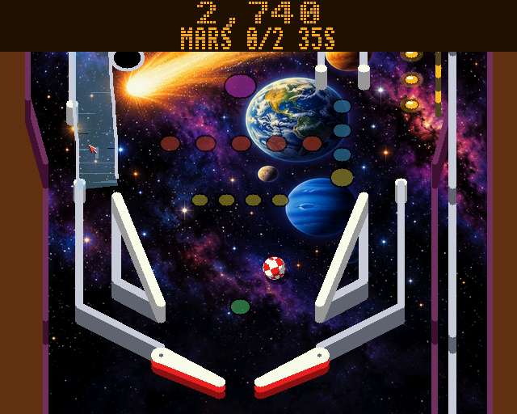
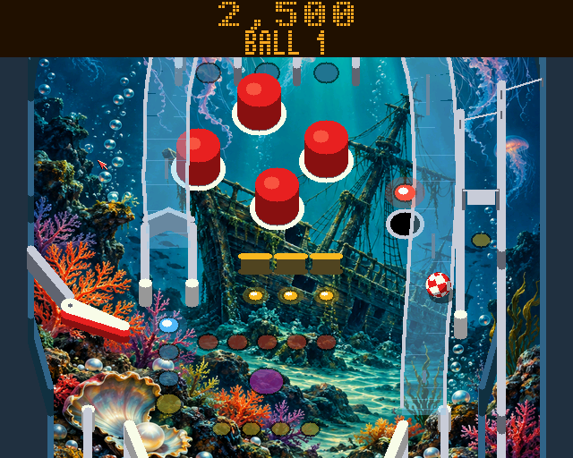
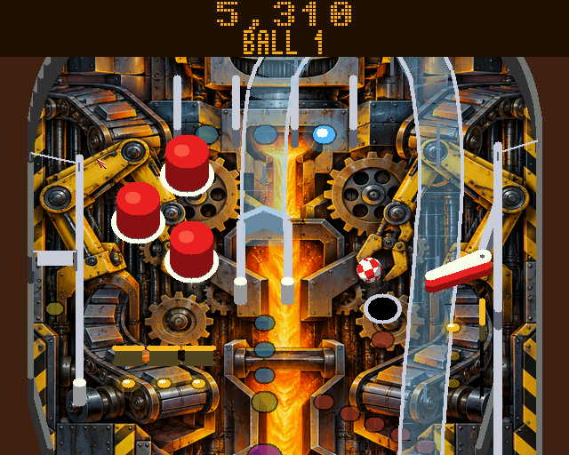
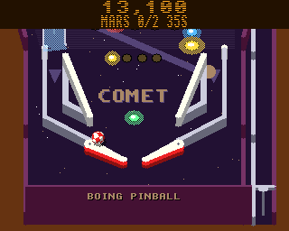

# Boing Pinball

Pinball with three tables, for the classic Amiga (68020 to 68060, OS 3.0+)
and AmigaOS 4.1 (PowerPC). A port of the browser game
[Boing pinball](https://geekychris.github.io/tools/boing-pinball/), on the
shared engine in [`../amiga3d`](../amiga3d/README.md), with two new
tables beside the browser's.

The ball is the Boing ball. The view is the classic Amiga pinball one:
the table seen from the player's end, tilted, scrolling to follow the
ball, with a dot-matrix display over it.

| Table | |
|---|---|
| **Comet Tour** | The browser's table: the ramp round to the left inlane, the left orbit past a spinner, three pop bumpers, a bank of three drop targets, the mission saucer. |
| **Deep Dive** | Four jellyfish bumpers, the ramp the other way (in on the left, round to the right inlane), a right orbit with the spinner, the target bank across the middle, an upper flipper on the left wall. |
| **Robot Foundry** | Two target banks, a centre ramp round to the right inlane, the left orbit, three bumpers at the top left, an upper flipper on the right wall. |

All three share the cabinet, the flippers, slingshots, inlanes and
outlanes, the top lanes and the plunger, and the rules.

| Key | Joystick | |
|---|---|---|
| Left Shift / Z (left Alt, left Amiga) | left | left flippers |
| Right Shift / `/` (right Alt, right Amiga) | right | right flippers |
| Space / Down / Return | fire / down | the plunger: hold to pull back, let go to launch |
| Left, right, up | up | nudge the table |
| P | | pause |
| Help / H | | the controls and the rules |
| Esc | | the title / quit |

On the title, left and right (or the flippers) choose the table while
the demo player plays it; fire starts a game.

## Screenshots

AmigaOS 4, with the painted backglasses and playfields:

| | |
|---|---|
|  |  |
|  |  |

The classic Amiga (32 colours, 320 x 256):



## The rules (the browser's)

- **Skill shot:** on the plunge, the flashing top lane is worth 10,000.
- **Top lanes:** light all three for the next bonus multiplier (up to
  5x); the flippers move the lit lanes round.
- **Ramps:** three lock balls and start multiball (three balls); in
  multiball every ramp is a jackpot, 50,000 and 10,000 more each time.
- **Missions:** the saucer, when lit, starts one of five (pop bumpers,
  target banks, spins, ramp shots, lane sets) with 40 seconds to finish
  it. All five lead to **Supernova**: everything scores 3x for 30 seconds,
  with multiball.
- **Ball save** for the first ten seconds of a ball (and of multiball).
- **Tilt:** nudging too often gives two warnings and then tilts the
  ball: dead flippers and no bonus.
- **End-of-ball bonus:** ramps, targets, lanes and spins, times the
  multiplier.

## How it works

- `pb_core.c` is the browser's `boing-pinball-core.js` in 16.16 fixed
  point (a 68020 has no FPU): the same capsule and circle collisions, the
  flipper's surface velocity (w x r) at the contact, the one-way gates,
  the slingshots' and bumpers' kicks, the spinners, the saucer, the
  habitrail ramps, and the rules. Each 1/120 s step is split into
  substeps short enough that nothing tunnels; the ball tests only what is
  in its 64 mm grid cell, and the flippers add substeps only while they
  move, so a 68020 keeps up.
- `pb_tables.c` builds the tables from walls, posts, bumpers, targets,
  sensors, flippers and ramp paths, and the lamps and art.
- `render.c` draws each table once into a 320 x 512 picture (the
  engine's `g_pic`) when it's chosen: the playfield and its art, the
  walls and posts extruded upwards, the bumpers, the ramps (clear plastic,
  dithered, with chrome rails). Each frame the blitter copies the 224 rows
  in view under the display, and the CPU draws what moves: the flippers,
  the lit lamps, the standing targets, the spinners, the plunger, flashing
  bumpers and slingshots, and the Boing balls (eight frames of a spinning
  checked sphere, turned as they roll).
- `game.c` is the shell: input, the title (`pb_bot` plays the demo),
  sound effects, the music and the bridge interface.

### AmigaOS 4's artwork

On AmigaOS 4 everything is drawn at 640 x 512 in full colour (the ramps
are see-through plastic, lit lamps and flashing bumpers glow), and three
sets of paintings (`assets/`, made with ChatGPT from the prompts in
`../assets/chatgpt_prompts_os4.md`) go with each table. `make art` turns
them into the pictures the game loads from beside itself:

- `playfield_<table>.img`, from `playfield_<table>.png`: the printed
  playfield under the walls, bumpers and ramps, squashed into the view's
  tilt (x 0..520, y -60..1040 mm) and cut to the cabinet's outline; the
  unlit lamps become tinted see-through inserts over it.
- `title_<table>.img`, from `backglass_<table>.png` with `logo.png` laid
  on top: the title's attract page, ten seconds of it in turn with the
  demo; choosing a table shows its backglass.

Without them (and always on the classic Amiga) the tables keep their
drawn art and the title its chooser over the demo.

### Changes from the browser

Things the tests and the bot-played games turned up, fixed here:

- The one-way gates and the ramp entrances' caps are tilted or peaked, and
  the plunger lane's wall ends flush with its gate: in the browser a ball
  can come to rest on top of any of them.
- A ball that rolls back down the plunger lane comes to rest on the
  lane's floor 3 mm above where the browser looks for it, and would stay
  "in play" there for ever.
- The plunger works while the table is tilted (the browser's doesn't, so
  a ball sitting in the lane would then keep the ball alive for ever).
- The saucer's kick varies a little: with the same kick every time, a
  ball can loop orbit, saucer, slingshots, orbit for ever.

## Building and testing

```sh
scripts/build-example-68k.sh boing_pinball       # boing_pinball, boing_pinball_test
scripts/build-example-ppc.sh boing_pinball       # boing_pinball_os4
make -C examples/boing_pinball host-test         # 81 tests on the host
make -C examples/boing_pinball host-preview      # each table top down, bot-played statistics
make -C examples/boing_pinball art               # AmigaOS 4's pictures (playfield_*.img, title_*.img)
python3 examples/boing_pinball/tests/e2e_devbench.py [--url ... --remote HOST]
python3 examples/boing_pinball/tests/e2e_devbench.py --os4 HOST --url http://localhost:13002/mcp
```

The tests are the browser's suite ported (no tunnelling at the speed
limit or onto a raised flipper, w x r, the gates, the ramp, slingshots,
bumpers, targets, spinner, saucer, plunger, skill shot, lane change,
tilt, ball save, multiball, missions, Supernova, the display), the
collision functions and short flights checked against vectors from the
browser's own core (`tests/vectors.h`, from `tests/gen_vectors.js`; `make
vectors`), and for every table: the drain gap, the collision grid, every
ramp, spinner, target bank, the saucer and the bumpers reachable with a
flipper shot, and bot-played games in which no ball leaves the table,
sticks, or loops for ever. They run on the host, on the Amiga
(`boing_pinball_test`) and inside the game (`selftest`). The end-to-end
test starts a game, pulls the plunger and works the flippers with
injected keys, runs multiball and the tilt, plays a game out to game over
and visits every table, through devbench; it passes on FS-UAE (68060) and
on QEMU's AmigaOS 4.

Music: `boing_pinball.mod` ("Silver Ball Shuffle", `tools/modgen/boing_pinball.py`).

## Driving it from devbench

Variables: `score ball balls_left state pstate table multiball mission
locks bonus_x tilt_warn tilted ball_x ball_y ball_vx ball_vy ball_st
nballs flip_l flip_r cam paused help fps substeps us_update us_draw`
(positions in mm). Hooks: `status`, `start comet|deep|foundry`, `title`,
`table <name>`, `place x y [vx vy]`, `launch [0-1000]`, `flip l|r [ms]`,
`nudge l|r|u`, `event <name>` (`ramp`, `bumper`, `saucer`, `spin`,
`drop`, `laneA`...), `bot on|off`, `help 0-2`, `pause on|off`,
`activate`, `selftest`. The log has a line for each big event
(`EVENT multiball score ...`) and `STATE`, `START`, `GAMEOVER`.
