# Boing Twist

A twisty puzzle on the Boing ball, for AmigaOS 4.1 (PowerPC).

A picture is wrapped round the ball, the ball is cut into tiles along
lines of latitude and longitude, and the tiles are jumbled. Twist bands
of tiles round the ball and flip halves of it over until the picture is
whole again. The ball sits in a room: the first is the 1984 Boing demo's
grey room with its purple grid, the ball's shadow thrown on the back wall.
When you solve it the ball bounces round the room, spinning on its leaning
axis, as it did in the demo.

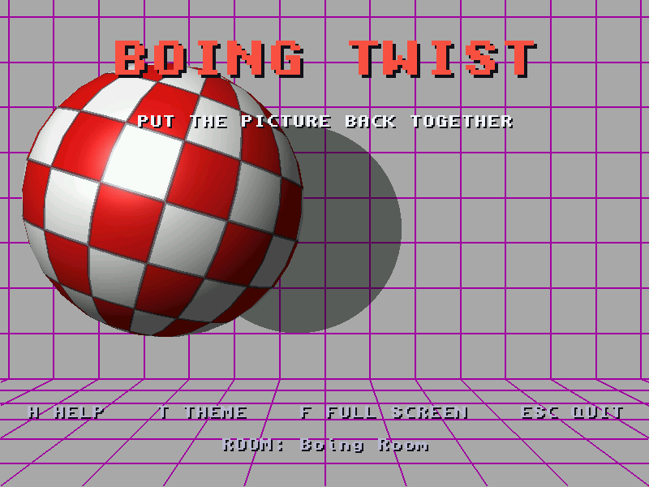

| | |
|---|---|
| 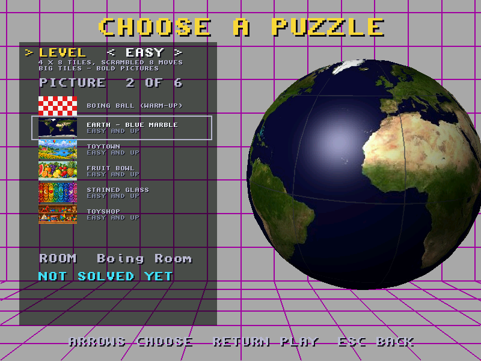 | 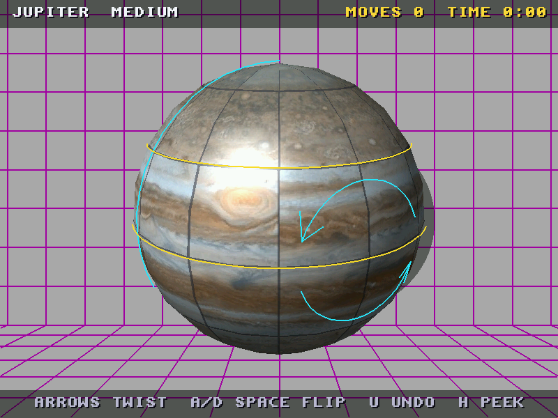 |
| Choosing a puzzle: the level, then the pictures it offers, then the room | Jupiter on a 6 x 12 grid, scrambled. Yellow rings: the band a twist turns. Blue: the half a flip turns over |
| 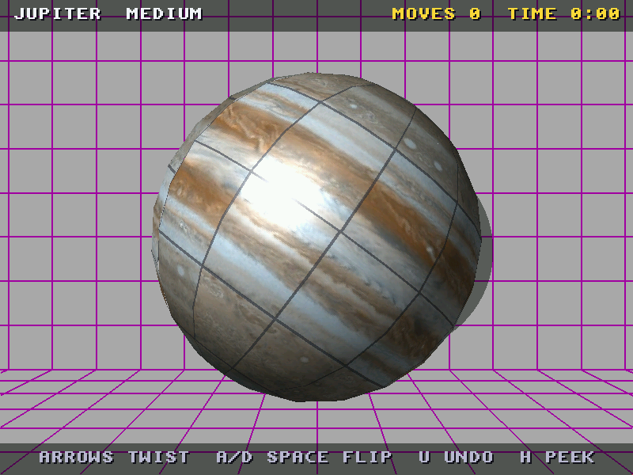 | 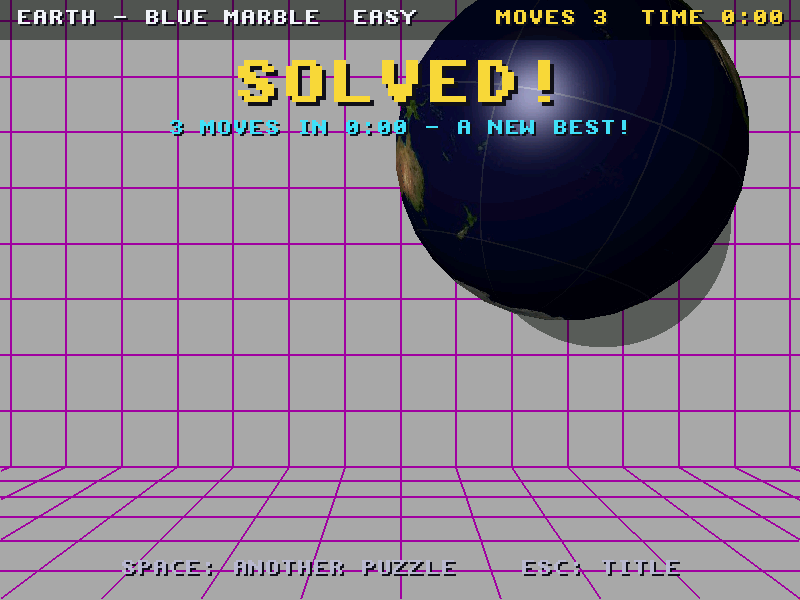 |
| A flip, half done | Solved: the ball bounces |
| 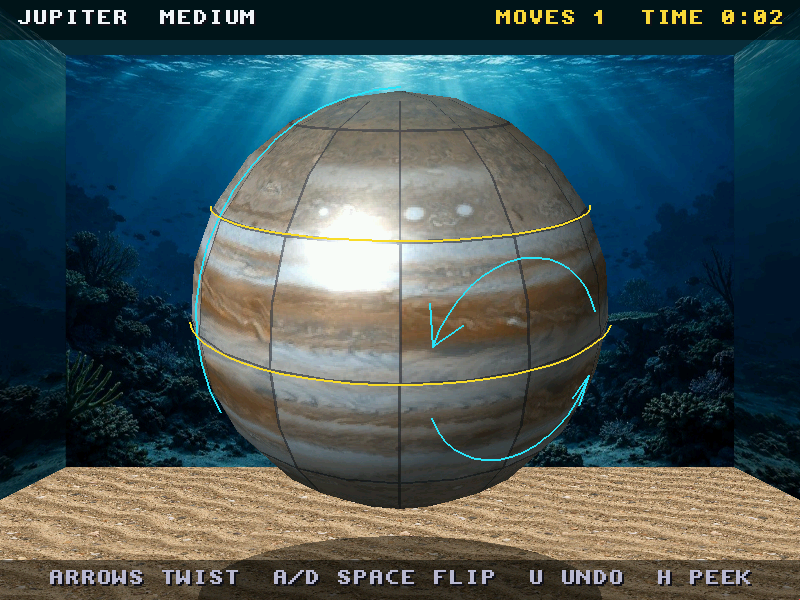 | 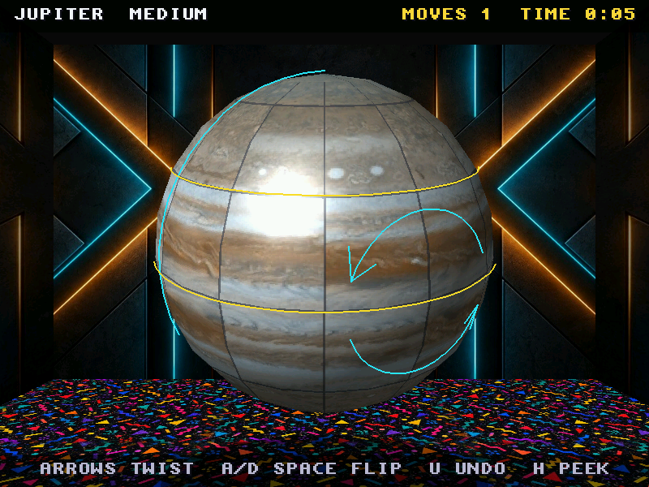 |
| The Midnight Box room | The Deep Space room (a texture on the back wall) |

## The puzzle

The ball is cut into **B bands** of latitude by **S segments** of
longitude, how many set by the level (below). There are two moves:

- **Twist** a band one tile east or west round the ball's vertical axis.
  Pieces stay in their band. S twists of a band are no move at all.
- **Flip** a half of the ball: the S/2 segments either side of a meridian
  turn 180 degrees about the horizontal axis through the middle of that
  half. A piece in band b goes to band B-1-b, mirrored across the half,
  and ends up upside down. This is the move that takes pieces between the
  northern and southern bands. Two flips of the same half are no move.

A scramble is a run of random legal moves from the solved ball (never one
that just undoes the move before it), so every scramble can be solved.
The ball counts as solved when every tile shows the picture that belongs
there, allowing for the whole ball having been spun round; tiles that look
the same (the Boing checkerboard's) count as the same piece, so the easy
Boing ball puzzle is "make the checkerboard again". Upside-down pieces are
not solved.

### Levels

The level sets both the grid and how long the scramble is:

| Level | Grid | Tiles | Scramble |
|---|---|---|---|
| Easy | 4 x 8 | 32 | 8 moves |
| Medium | 6 x 12 | 72 | 20 moves |
| Hard | 8 x 16 | 128 (the Boing ball's own) | 40 moves |
| Expert | 8 x 16 | 128 | 80 moves |

Each picture names the lowest level it suits (bold shapes and colours:
Easy; fine detail, or large plain areas where tiles look alike: Hard or
Expert), and a level offers the pictures that suit it or an easier one.
The red and white Boing checkerboard is offered on Easy only, as a
warm-up: its squares of one colour look alike, so it is really "make a
checkerboard again", and the select screen says so. A scramble that leaves
the ball solved is retried with another seed. Your best moves and time for
each picture and level are kept in `boing_twist.best` beside the program.

## Controls

| | Keyboard | Mouse |
|---|---|---|
| Choose the band | Up / Down | click a tile |
| Twist it | Left / Right | drag it sideways (one twist each 18 pixels) |
| Choose the half | A / D (the ball turns to face it) | click a tile |
| Flip it | Space / Return | drag a tile up or down |
| Turn the ball to look | Q / E (round), W / S (tilt), C (face the half) | right button drag |
| Zoom | + / - | |
| Undo | U / Backspace | |
| Peek at the picture | H (hold) | |
| Pause | P | |
| Give up (it solves itself, move by move) | R | |
| New scramble | N | |
| Room | T | |
| Full screen / window | F / F10 | |
| Help | Help / F1 | |
| Back, then quit | Esc | |

On the title: Space or a click to choose a puzzle. On the select screen,
Up/Down moves between the level, the picture list and the room, and
Left/Right changes the one chosen (the picture list scrolls; each picture
shows its thumbnail, the lowest level it suits and whether a room comes
with it, and choosing it changes to that room). Return (or a click on the
ball) plays.

```
boing_twist [RES=640|800|1024] [FULLSCREEN] [FLAT] [LINEAR]
```

`RES` is the frame: 640 x 480, 800 x 600 (the default) or 1024 x 768. A
frame too big for the Workbench opens on a screen of its own. `FLAT` turns
the ball's shading off; `LINEAR` smooths the textures (much slower, see
below).

## Pictures

| | Picture | Level | Source | Licence |
|---|---|---|---|---|
| 1 | The Boing ball (warm-up) | Easy only | made by the game, red and white, one square per tile | - |
| 2 | Earth - Blue Marble | Easy | NASA Visible Earth, *Blue Marble: Land Surface, Shallow Water, and Shaded Topography* (Reto Stöckli, NASA Goddard): <https://visibleearth.nasa.gov/images/57752>, file <https://eoimages.gsfc.nasa.gov/images/imagerecords/57000/57752/land_shallow_topo_2048.jpg> | Public domain (NASA) |
| 3 | The Moon | Hard | NASA Scientific Visualization Studio, *CGI Moon Kit* (LRO LROC colour mosaic): <https://svs.gsfc.nasa.gov/4720>, file `lroc_color_poles_2k.tif` | Public domain (NASA) |
| 4 | Mars | Medium | Viking MDIM 2.1 colour mosaic, NASA / USGS Astrogeology, via Wikimedia Commons: <https://commons.wikimedia.org/wiki/File:Mars_Viking_MDIM21_ClrMosaic_1km.jpg> | Public domain (NASA/USGS) |
| 5 | Jupiter | Medium | Cassini cylindrical map, December 2000, NASA/JPL/Space Science Institute (PIA07782): <https://photojournal.jpl.nasa.gov/catalog/PIA07782>, via <https://commons.wikimedia.org/wiki/File:Jupiter_Cylindrical_Map_-_Dec_2000_PIA07782.jpg> | Public domain (NASA) |

And thirteen pictures made for the game with ChatGPT (the prompts are in
the user's `amiga_knowledge/output/boing-twist-artwork/prompts.json`),
imported with `tools/import_art.py` (`images/artwork_manifest.csv`):

| | Picture | Level | Comes with the room |
|---|---|---|---|
| 5 | Toytown | Easy | |
| 6 | Fruit Bowl | Easy | |
| 7 | Stained Glass | Easy | |
| 8 | Toyshop | Easy | |
| 9 | Coral Reef | Medium | Aquarium |
| 10 | Four Seasons | Medium | |
| 11 | Old Map | Medium | Study |
| 12 | Steampunk | Medium | Workshop |
| 13 | Alien World | Medium | Observatory |
| 14 | Butterflies | Hard | |
| 15 | Mosaic | Hard | |
| 16 | Circuit Board | Hard | Retro Room |
| 17 | Flower Garden | Hard | Garden |

Choosing a picture that comes with a room changes to it (T or the select
screen's room line still change it). `images/` holds all the pictures at
2048 x 1024 (JPEG, quality 90) and `themes/src/` the rooms' walls and
floors; `make data` makes what the game reads from them.

| | | |
|---|---|---|
| 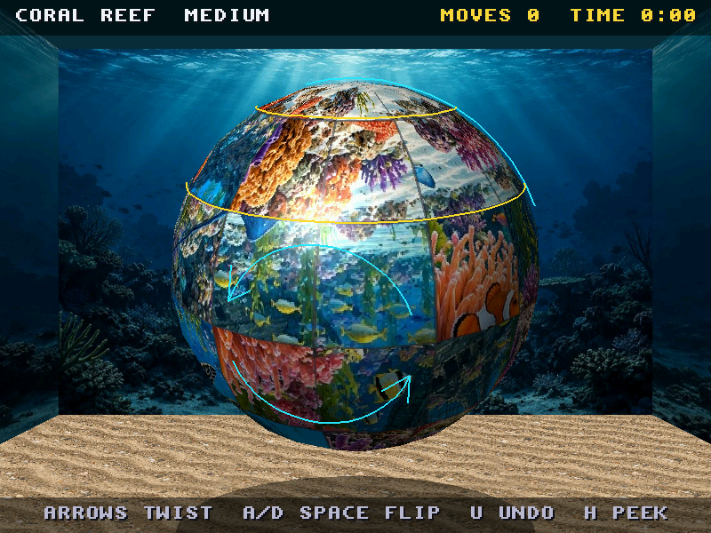 | 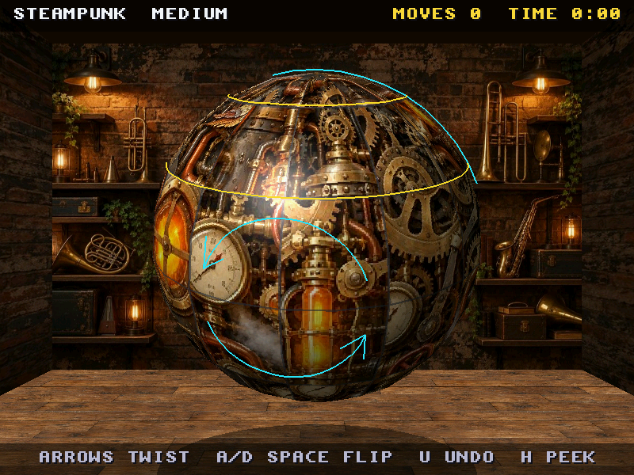 | 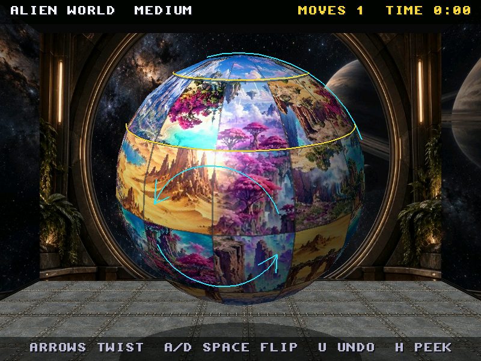 |
| Coral Reef, in the Aquarium | Steampunk, in the Workshop | Alien World, in the Observatory |
| 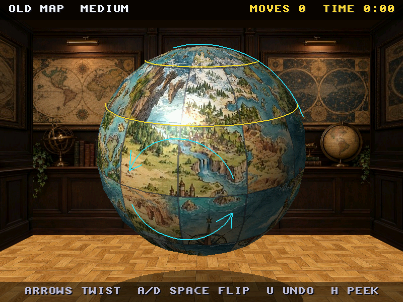 | 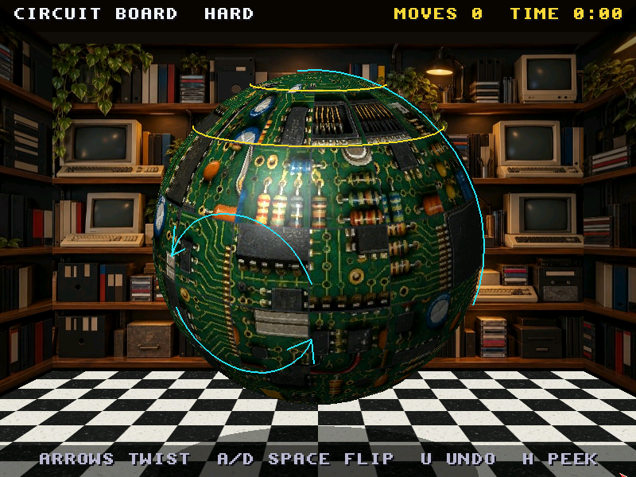 | 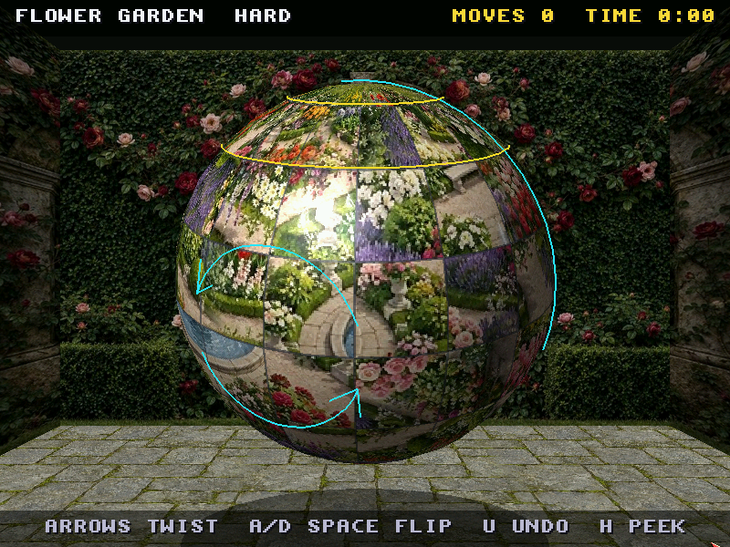 |
| Old Map, in the Study | Circuit Board, in the Retro Room | Flower Garden, in the Garden |

The import, for the record: Mosaic and Four Seasons change colour from
left to right, so their seams are cross-faded over 12% of the width
rather than 3%; the Retro Room's checkerboard floor already tiles, so it
is used as it is (blending its edges smeared the squares); and the
Observatory's back wall has a floor painted into its bottom fifth, which
is cut off (`crop_bottom 0.22`) so the room's own 3D floor meets the wall
where the painted one began.

### Adding your own: the import tool

`tools/import_art.py` takes a folder of generated art (ChatGPT's 1536 x
1024 and 1024 x 1024 PNGs, or anything else) and does the rest:

```
python3 tools/import_art.py ~/Downloads/boing_art             # by file name
python3 tools/import_art.py ~/Downloads/boing_art --manifest art.csv
    [--seam 3] [--poles 0.05] [--sides crop|colour|off] [--repeat 4]
    [--contact sheet.png] [--dry-run] [--no-make]
```

Name the files

| | |
|---|---|
| `ball_<level>_<name>.png` | a ball picture; level `easy`, `medium`, `hard` or `expert`: the lowest it suits |
| `room_<name>_back.png` | a room's back wall (landscape; 3:2 is fine) |
| `room_<name>_floor.png` | its floor (square; it is made to tile) |

or keep ChatGPT's own names and list them in a CSV:

```
file,kind,name,level,title,room
"DALL-E 2026-10-31 12.00.00 - a pastel planet.png",ball,pastel,medium,Pastel Planet,neon
neon wall.png,back,neon,,Neon Arcade,
neon floor.png,floor,neon,,,
```

For a **ball picture** it

- cuts the middle 2:1 out (a 3:2 picture loses a sixth at the top and
  bottom; a square one a quarter: ask for the subject in the middle band),
- cross-fades the left and right edges over `--seam` percent of the width
  (default 3), so the join at the back of the ball doesn't show,
- with `--poles 0.05`, fades the top and bottom 5% to each row's average
  colour (the poles squeeze a whole row into a point),
- writes `images/<n>_<name>.jpg` (2048 x 1024; the next free number, or
  the old one when a name is imported again) and its line in
  `images/titles.txt`: `<n>_<name> = Title | level | room`. A ball paired
  with a room (the manifest's `room`, or a room of the same name in the
  same import) changes the game to that room when it is chosen.

For a **room** it writes `themes/src/<name>_back.png` and `<name>_floor.png`
(the floor's opposite edges cross-faded so copies join), the side walls
(`--sides crop`: the back wall's outer thirds, darkened; `colour`: its
average colour; `off`: none) and `themes/<name>.theme`, with the floor
tiled `--repeat` times across.

It also takes, per file in the manifest, `seam` (a ball picture's
cross-fade width in percent, for one whose colours drift across it; for a
floor, its edge blend, 0 to keep one that already tiles), `crop_bottom` (a
back wall: cut a painted floor off its bottom) and `repeat` (a floor's
tiles across).

Then it runs `make data` and writes a contact sheet (`import_contact.png`
in the art folder): each picture flat and on a ball, from the front and
from the back with the seam in the middle, and each room's walls with its
floor tiled two by two. Check it, then copy `data/` and `themes/` beside
the program; the game lists whatever is there when it starts, no rebuild.

[The contact sheet of the ChatGPT artwork's import](screenshots/artwork_contact.jpg): each picture flat, on a ball from the front, and from the back with the seam in the middle; each room's walls and its floor tiled two by two.

| | |
|---|---|
| 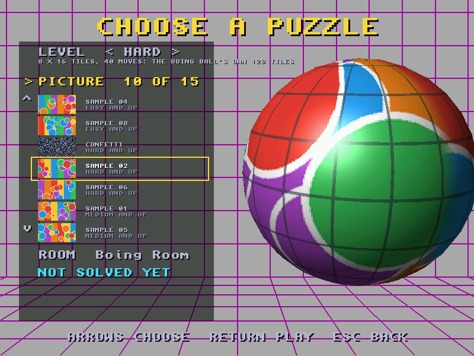 | 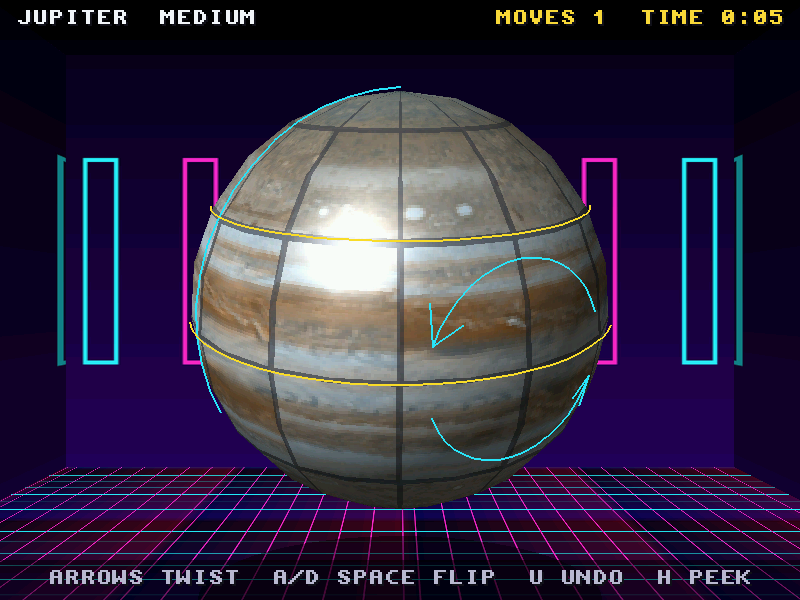 |
| 15 pictures on Hard: the list scrolls (stand-in art from `tests/make_sample_art.py`) | An imported room: back wall, cropped side walls, tiled floor (stand-in art) |

**Tips for prompts.** Ask for "an equirectangular 360-degree map,
seamless left to right" and keep the interesting things in the middle
band, away from the top and bottom (they are cropped, and the poles are
squeezed). Bold shapes and strong colours make Easy pictures; for Hard and
Expert, fine detail everywhere, so no two tiles look alike. For a room's
back wall, a landscape picture seen square-on; for its floor, a square,
seamless tile.

By hand, without the import tool: put a 2:1 picture in `images/`, add its
`titles.txt` line, `make data` (or `python3 tools/make_texture.py --all`).
One file: `python3 tools/make_texture.py in.png data/name.btx --title
"NAME" --level medium --room neon`.

### The .btx files

`make data` writes `data/<name>.btx` (BTX3): `"BTX3"`, width and height
(16-bit big-endian, powers of two), a 32-byte title, the level (0-3), 3
spare bytes, a 24-byte room name, the thumbnail's size (128 x 64) and its
R G B bytes, then the picture as a JPEG (its length, 32-bit big-endian,
then the JPEG, quality 90), which the game decodes with Sean Barrett's
`stb_image.h` (public domain / MIT, JPEG only): 17-31 ms a picture on the
QEMU guest. Room textures are the same. Raw pixels made the game's drawer
59 MB (a 41 MB zip); JPEG, 10.5 MB (8.6 MB zipped), with 17 pictures and
10 rooms. `--raw` still writes the uncompressed BTX2, and BTX1 (no level,
room or thumbnail) still loads.

The game reads only the header and thumbnail of each picture when it
starts (24 KB each, for the list) and decodes one picture at a time, when
it is chosen and left chosen a quarter of a second (1.5 MB at 1024 x 512).
On the guest the game takes 24 MB of fast memory at start (most of it
OSMesa and the 800 x 600 frames); going through all 17 pictures and 10
rooms takes up to 12 MB more (newlib's allocator keeps its peak), a
second pass none, and quitting gives it all back. 512 x 256 (`--size
512x256`) halves a picture's memory and draws a little faster (27-29 fps
against 25 at 800 x 600), looking softer close up.

## Rooms (themes)

A room is a text file in `themes/` (`*.theme`), listed by the game at
start-up; T changes room. The room is a box round the ball: back wall,
floor, left and right walls and ceiling, each a colour with an optional
grid, an optional texture, or left out:

```
name = Boing Room
background = AAAAAA              # behind everything (RRGGBB)
shadow = wall 45                 # wall|floor <darkness 0-100> | off
back = AAAAAA A000A0 0.5         # <colour> <grid colour | none> <grid square> [texture.btx]
floor = AAAAAA A000A0 0.5
left = off
right = off
ceiling = off
```

The grid square is in ball radii. A texture is a `.btx` in `themes/`
(made by `tools/make_texture.py`; pictures in `themes/src/` are converted
by `make data`: a back wall (`*_back`) at 1024 x 512, the rest at 512 x
512), stretched over the part of that face that
can be seen, or tiled when a fifth number follows (`floor = 101018 none 0
neon_floor.btx 4`: four squares across); a grid is drawn over it unless it
is `none`. Ten rooms come with the game: **Boing Room** (the demo's,
always first, and the one the game starts in), **Midnight Box** (all five
faces, a cyan grid, the shadow on the floor), **Deep Space** (`stars.btx`,
made by `make_texture.py --stars`, on the back wall), and seven from the
ChatGPT artwork: **Aquarium**, **Arcade**, **Garden**, **Observatory**,
**Retro Room**, **Study** and **Workshop** (a painted back wall, side walls
cropped from it and darkened, a tiled floor). To map
your own pictures onto the box, `tools/import_art.py` makes the room from
a back wall and a floor (above), or make one per face by hand (the back
wall is seen square-on and about 4:3; the floor, walls and ceiling in
perspective), put them in `themes/src/`, `make data`, and name them in a
new `.theme`.

The room is drawn once, when it is chosen, into a background picture; it
costs nothing while playing, so textures there can be any size.

## Building and running

```
../../third_party/mesa-os4/build.sh        # once, in amiga_mcp: libOSMesa
scripts/build-example-ppc.sh boing_twist   # in amiga_mcp
make data                                  # the pictures and textures (Pillow)
```

From a git worktree of `examples/` (Docker must see both), `./build.sh`
runs the same Docker build with `amiga_mcp` mounted beside it. The build
checks that the binary has no `dlmzb` instructions (it is built with
`-mcpu=powerpc`, never 440).

To run, copy `boing_twist`, `data/` and `themes/` into one drawer and start
`boing_twist` from a Shell there. The `$STACK` cookie asks for 2 MB of
stack (Mesa's rasteriser keeps whole spans on it).

## How it is drawn, and how fast

Software Mesa (OSMesa 7.8.2, `third_party/mesa-os4`), into a 32-bit frame
that one `WritePixelArray` puts on the window or screen. The camera never
moves, so the room is drawn into a background buffer when it is chosen;
each frame copies that, darkens the ball's shadow into it in C, draws only
the ball in GL, shades it, and draws the text in C.

The ball is a mesh per tile (about 32 quads round the equator), each tile
textured with the part of the picture its piece carries, turned round if
the piece is upside down. The grooves between tiles are drawn into a copy
of the picture (cut for the grid in use), not as geometry. Tiles facing
away are skipped before GL sees them.

What makes it fast enough: OSMesa has a fixed-point textured-triangle
function that it only uses with `GL_REPLACE`, `GL_NEAREST`, an RGB
power-of-two texture and `GL_FASTEST`. Shading the ball with `GL_MODULATE`
(colour per vertex) falls back to Mesa's general span code, whose
per-pixel floating point crawls on QEMU's emulated FPU: **1125 ms** a
frame against **26 ms** for the same ball. So the ball is drawn unshaded
and shaded afterwards in C: the light is fixed to the eye, so the shade of
a pixel of the ball depends only on where it is in the ball's outline (an
ellipse, in perspective), and a table gives it (diffuse light and a
highlight), for about 2-6 ms. And the ball needs no depth buffer: it is
convex and its back faces are culled, so the depth test is off (28% less
time), the shading finds the ball's pixels by what changed, and the
selection rings are clipped to the near side in C.

Measured on the QEMU sam460ex guest (AmigaOS 4.1 FE), the Earth on a
4 x 8 grid, the ball turning every frame (the `bench` hook), shaded:

| Frame | ms per frame | fps | of which: ball (GL + shading) | blit |
|---|---|---|---|---|
| 640 x 480 (window) | 32 | 31 | 26 (2) | 3 |
| 800 x 600 (window, the default) | 40 | 25 | 31 (4) | 5 |
| 1024 x 768 (full screen) | 57 | 17.5 | 44 (6) | 9 |

Triangle set-up costs about 29 us a triangle (the mesh detail, `detail`
16 / 24 / 32 / 48, gave 25 / 21 / 18 / 14 fps at 800 x 600 before the
depth test went), the rest is filling pixels. The frame rate only matters
while something moves: a ball standing still isn't redrawn, so the game
sleeps between moves. Frames are paced at 30 a second at most on
timer.device (never `WaitTOF`), with at least 3 ms of sleep each, so the
bridge and the rest of the system keep running. `LINEAR` (bilinear
filtering) takes the slow path again and is only there to compare.

## Tests

```
make host-test     # the puzzle core on the host (18,567 checks)
make ubsan         # the same under UBSan and ASan
make vectors       # regenerate tests/vectors.h
make test-tools    # import_art.py and make_texture.py on stand-in art (28 checks)
python3 tests/e2e_devbench.py --deploy [--art] [--readme] [--bench-res 640,1024]
```

The puzzle core (`bt_core.c`: state, moves, scrambles, undo, the solved
test, a xorshift RNG) has no Amiga headers. The host tests check that S
twists, four quarter turns and two flips are no move, that every move
followed by its inverse is none, that moves are permutations that turn the
right pieces, that scrambles replayed backwards solve the ball, the solved
test (a spun ball, a checkerboard, an upside-down ball), undo, the levels
(each a valid grid, harder than the one before, every start unsolved and
solvable, a checkerboard's scramble retried), and a long
deterministic run folded into one hash (`tests/vectors.h`). The game's
`selftest` hook runs the same run on the Amiga and must get the same hash.

`tests/test_import.py` makes stand-in art (`tests/make_sample_art.py`:
1536 x 1024 and 1024 x 1024 pictures, rooms, a ChatGPT-style file name and
a manifest) and imports it into a scratch folder: 2:1 crops, the seam
blended (edge difference 55 -> 2), titles.txt lines with levels and rooms,
re-imports keeping their numbers, the room's theme with its cropped walls
and a floor that tiles, `--poles`, the BTX3 files `make data` writes (the
header, the thumbnail, a JPEG that decodes to the picture) and `--raw`.

`tests/e2e_devbench.py` drives the game on the OS4 guest through devbench
(it takes the emulator lock and shows amiga_mcp's "CLAUDE IS TESTING"
banner, and pushes to `RAM:boing_twist/`, never the HDF). With `--art` it
first loads every picture and room (each decoded, none missing), checks
memory (a second pass takes none, quitting gives it all back) and
photographs each picture that comes with a room in it. Then:
the self-test; levels (a picture an easier level doesn't offer is swapped,
Expert is 8 x 16), a picture bringing its room, the picture list scrolled
(with more than nine pictures), best scores kept per picture and level;
scrambles and moves through the hooks, the keys and undo,
each state's hash checked against the host core (`tests/host_tests --hash`);
peek, the three rooms, an animated and an instant solve, a solve by the
player's moves, a 6 x 12 ball; a frame-rate bench; and Esc quitting from
the title with the launcher left running. Screenshots come from QEMU's
monitor; `--readme` takes the ones in `screenshots/`.

Bridge (client `boing_twist`): hooks `selftest`, `scramble` (seed
[length [level]]; length -1 or the level's own is animated, any other is
set at once), `state` (screen, solved, moves, level, picture ... as
name=value: devbench's variables are found by name alone, so the tests
read these, which can't be another game's), `move`
(`T<band>+`, `T<band>-`, `F<half>`, `!` for no animation), `hash`, `solve`
(`anim` or `now`), `undo`, `picture` (moving to a level that offers it), `theme`, `screen`, `view` (yaw pitch
distance band half), `peek`, `pause` (freezes a move half done, no
overlay), `bench` (frames), `activate`, `quit`; variables `screen`,
`moves`, `secs`, `solved`, `hash`, `anim`, `bands`, `pic`, `npics`,
`level`, `theme`, `nthemes`, `sel_band`, `sel_half`, `peeks`,
`paused`, `fps10`, `bench_fps10`, `bench_left`, `ms_bg`, `ms_ball`,
`ms_shade`, `ms_hud`, `ms_blit`, `tris`, `width`, `height`, and the
render options `lit`, `linear`, `detail` and `zbuf` (settable).

## Files

| | |
|---|---|
| `bt_core.c/h` | the puzzle (host-tested) |
| `render.c/h` | the ball and room in OSMesa, the shading, picking |
| `main_os4.c` | screens, input, pictures, themes, best scores, bridge |
| `hud.c/h` | text and panels in C over the frame |
| `os4_display.c/h` | window / full screen (planet_chomp's, with the mouse) |
| `sound_ahi.c/h` | the bounce, click, whoosh and chord, synthesised, through AHI |
| `tools/make_texture.py` | pictures and room textures to `.btx` |
| `tools/import_art.py` | generated art to pictures and rooms |
| `stb_impl.c`, `stb_image.h` | the JPEG decoder (stb_image v2.30, public domain / MIT) |
| `tests/make_sample_art.py`, `tests/test_import.py` | stand-in art; the tools' tests |
| `images/`, `themes/` | the pictures' sources; the rooms |

MIT licence (the code). The pictures are NASA's / USGS's, public domain,
as above.
