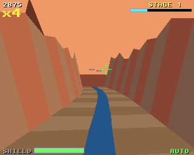
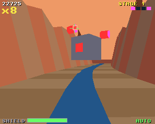

# Canyon Rail

A rail shooter down a winding canyon, for the classic Amiga (68020 to
68060, OS 3.0+) and AmigaOS 4.1 on PowerPC, from one source on the shared
[`amiga3d`](../amiga3d/README.md) engine.

The ride takes you down the canyon at a steady speed; you move the sight
and fire. Turrets on the walls and drones swooping across fire bolts at
you. Shoot those down too, or your shield takes them. At the end of each
stage the ride stops before a guardian.




## The game

- **Turrets**: on the canyon walls; two hits.
- **Drones**: swoop across the canyon; one hit.
- **Bolts**: their shots, aimed where you will be; shoot them down for 25
  each, or lose 12 shield points when one lands.
- **Fuel pods**: shoot them for +25 shield.
- **The guardian**: a core with four nodes orbiting it, each firing in
  turn. Shoot out all four (4 to 6 hits each) to finish the stage.
- Hits in a row build a multiplier, up to x8, on everything you score.
  A miss or a hit taken resets it.
- 3 stages, each with more targets, quicker fire and faster nodes.
- Scoring: turret 100, drone 150, bolt 25, pod 50, node 500, guardian
  2000 x the stage, all x the multiplier.
- An autopilot (B) shoots on its own; it also rides behind the title.

## Controls

| | |
|---|---|
| Arrows / WASD / joystick | move the sight |
| Space / fire | fire (held: five shots a second) |
| P | pause |
| B | autopilot on / off |
| Help / H | the rules and controls |
| Esc | back to the title, or quit from it |

## Building

```sh
scripts/build-example-68k.sh canyon_rail   # canyon_rail, canyon_rail_test
scripts/build-example-ppc.sh canyon_rail   # canyon_rail_os4
make -C examples/canyon_rail host-test     # the tests on the host
make -C examples/canyon_rail ubsan         # the same under UBSan and ASan
make -C examples/canyon_rail vectors       # regenerate tests/vectors.h
```

No data files: the effects are synthesised at start-up and there is no
music, so the binary is all you need.

## How it works

- `cr.h`, `cr_core.c`: the rules, with no Amiga headers. The ride's line,
  the canyon's width and everything's place are functions of how far
  along the ride you are. What the sight is on is found by projecting
  with the engine's own camera (`a3d.h` has no Amiga headers either), so
  a hit is decided exactly as it is drawn. A bolt flies from where it was
  fired to where the camera will be when it arrives.
- The autopilot deals with the most urgent thing first: a bolt about to
  land, otherwise the nearest target (or the node nearest the sight). It
  steers the sight onto it and fires when it is close enough to hit.
- `render.c`: the canyon in slabs 100 long out to the view range (1300 on
  the classic Amiga, 2200 on AmigaOS 4; `view_ahead` changes it live).
  Each slab has its floor and river and two rock walls sloping out as they
  rise, with spires along the rim. Turrets, drones and the guardian are
  models; pods, bolts and explosions are drawn facing the camera. The HUD
  has the sight, a tracer for each shot, the shield, the multiplier and
  the distance to the guardian.
- `game.c`: input, sound, the title, game over and the bridge.

## Testing

`tests/test_cases.c` runs on the host, as `canyon_rail_test` on the
Amiga, and inside the game (the `selftest` hook). It covers the ride and
the canyon, the sight, hits through the projection and misses, the rate
of fire, turrets taking two hits, pods (and the shield's cap), the
multiplier, a bolt landing and one shot down, targets passed by, the
guardian (the ride stopping, its nodes shot out) and the stage flow, and
the shield running out. It also checks the autopilot clearing stages 1
(three seeds) and 3. Finally it plays the whole game on the autopilot and
checks the state hash against the host's (`tests/vectors.h`), so the
Amiga must play exactly the same game.

`tests/e2e_devbench.py` drives the running game through devbench: the
self-test, the title, moving the sight and firing with injected keys (a
hit on a turret the `aim` hook puts the sight on, and a miss into the
sky), the autopilot riding a stage and shooting down its guardian, the
shield running out, the help pages, timings and stopping.

```sh
python3 tests/e2e_devbench.py --url http://localhost:3001/mcp           # classic Amiga (builds and deploys)
python3 tests/e2e_devbench.py --os4 local --url http://localhost:3000/mcp --launch RAM:canyon_rail
```

Results on 2026-10-30: 30/30 host tests (also under UBSan and ASan);
22/22 end-to-end on FS-UAE (an A1200's 68020: 25 fps, about 25 ms to draw
a frame) and 21/21 on AmigaOS 4.1 under QEMU (25 fps, about 3.4 ms a
frame).

The autopilot is a crack shot: on the host it clears all three stages on
every one of 10 seeds without taking a hit, at about 97% accuracy.

## Bridge

- vars (25): `score stage shield combo shots hits kills hurt boss nodes
  ride sight_x sight_y state over won autoplay start_stage view_ahead
  paused help fps polys us_update us_draw`
- hooks: `status`, `start [stage]`, `title`, `autoplay on|off`,
  `guardian` (on to the ride's end), `aim` (the sight onto the nearest
  turret in view), `shield N`, `help N`, `pause on|off`, `selftest`,
  `activate`
