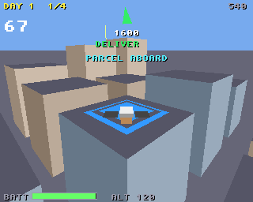
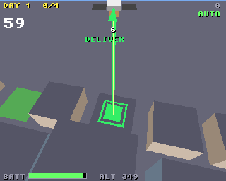

# Drone Courier

Parcel deliveries by drone across a city of towers, for the classic Amiga
(68020 to 68060, OS 3.0+) and AmigaOS 4.1 on PowerPC, from one source on
the shared [`amiga3d`](../amiga3d/README.md) engine.

Each job: fly to the depot's blue rooftop pad and land to collect a
parcel, then land it on the customer's green pad before the clock runs
out. The arrow at the top and a beacon over the pad show the way.




## The game

- Touch down gently on the pad: under 2 a tick down and 1.5 across.
  Harder, and you have to try again.
- From day 2 some parcels are fragile (red). Land one hard or knock a
  tower with it and it breaks.
- Clip a tower's side and the drone bounces off it.
- The battery drains as you fly, faster when climbing, and is charged
  each time you collect at the depot. A flat battery ends the game.
- The wind blows from day 2 and gusts, harder each day; the pads get
  smaller.
- 5 days of 4 to 8 jobs. Three failed jobs (a broken parcel, or the
  clock running out) end the game.
- Scoring: 200 a delivery, + 5 for each second left and 150 for a
  fragile parcel; 500 x the day for finishing it.
- An autopilot (B) flies on its own; it also flies behind the title.

## Controls

| | |
|---|---|
| Up / down (W / S, joystick) | forward / back |
| Left / right (A / D, joystick) | turn |
| Space / fire | climb (let go and it sinks slowly) |
| P | pause |
| B | autopilot on / off |
| Help / H | the rules and controls |
| Esc | back to the title, or quit from it |

## Building

```sh
scripts/build-example-68k.sh drone_courier   # drone_courier, drone_courier_test
scripts/build-example-ppc.sh drone_courier   # drone_courier_os4
make -C examples/drone_courier host-test     # the tests on the host
make -C examples/drone_courier ubsan         # the same under UBSan and ASan
make -C examples/drone_courier vectors       # regenerate tests/vectors.h
```

No data files: the city is generated from the seed, the effects are
synthesised at start-up and there is no music, so the binary is all you
need.

## How it works

- `dc.h`, `dc_core.c`: the rules in 16.16 fixed point, with no Amiga
  headers. The city is a 12 x 12 grid of blocks, towers taller towards
  the middle, about one block in ten a park. The drone moves in two half
  steps a tick. Coming down into a tower's footprint from above is a
  landing; coming in from the side puts it back where it was, with that
  axis' speed reversed at 30%.
- The autopilot climbs above the skyline before going anywhere far, flies
  at the pad allowing for its drift, slows as it nears it, and settles
  straight down onto it.
- `render.c`: **culling by grid cell (a proposed engine addition)**. Only
  the cells in the square round the camera out to the view range are
  visited, and only the towers ahead of the camera are drawn. That is about
  28 of the 144 on the classic Amiga (range 560), and about 64 on AmigaOS 4
  (range 1400). The `view_range` variable changes it live and `towers`
  reports the count. Each tower is its roof and the walls facing the
  camera. The chase camera looks down at the ground under the drone, so
  the roof below stays in view at any height.
- `game.c`: input, sound, the title, game over and the bridge.

## Testing

`tests/test_cases.c` runs on the host, as `drone_courier_test` on the
Amiga, and inside the game (the `selftest` hook). It covers the city,
flying (forward, turning, climbing, sinking), the wind (in the air, not on
a roof), settling onto roofs, bouncing off towers, a fragile parcel
breaking, delivering and collecting on the pads, landing off the pad, a
hard landing, the clock, the battery and the days. It also checks the
autopilot working whole days (day 1 on three seeds, day 4). Finally it
flies a long autopilot game and checks the state hash against the host's
(`tests/vectors.h`), so the Amiga must fly exactly the same game.

`tests/e2e_devbench.py` drives the running game through devbench: the
self-test, the title, climbing and flying with injected keys, a delivery
and a collection settled onto the pads, the autopilot delivering, three
late jobs ending the game, the help pages, timings and stopping.

```sh
python3 tests/e2e_devbench.py --url http://localhost:3001/mcp           # classic Amiga (builds and deploys)
python3 tests/e2e_devbench.py --os4 local --url http://localhost:3000/mcp --launch RAM:drone_courier
```

Results on 2026-10-30: 30/30 host tests (also under UBSan and ASan);
22/22 end-to-end on FS-UAE (an A1200's 68020: 25 fps, about 27 ms to draw
a frame) and 21/21 on AmigaOS 4.1 under QEMU (25 fps, about 3 ms a frame).

On the host the autopilot finishes days 1 to 5 on all of 10 seeds, with
no bumps or hard landings; on day 5 it is late on 5 jobs in 80.

## Bridge

- vars (29): `score day jobs jobs_done fails battery job_s carrying
  fragile target state over won autoplay x y z speed landed bumps
  start_day view_range towers paused help fps polys us_update us_draw`
- hooks: `status`, `start [day]`, `title`, `autoplay on|off`,
  `hop [ABOVE]` (hovering over the next pad), `job S`, `battery N`,
  `help N`, `pause on|off`, `selftest`, `activate`
