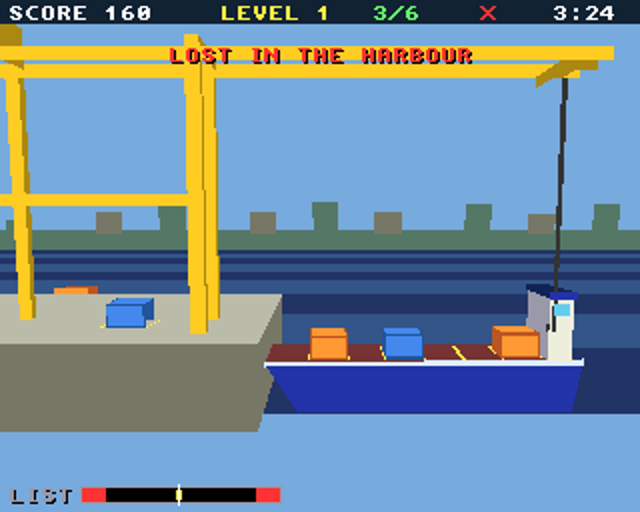
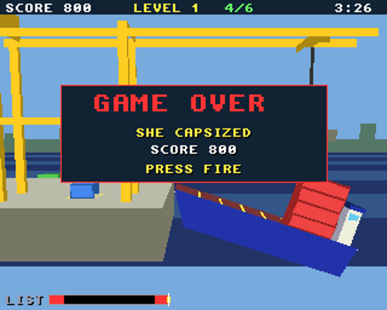

# Harbour Crane

A gantry crane loading a ship that rolls in the swell, for the classic
Amiga (68020 to 68060, OS 3.0+) and AmigaOS 4.1 on PowerPC, from one
source on the shared [`amiga3d`](../amiga3d/README.md) engine.

The crane runs from the quay out over the ship. Its trolley moves along
the gantry, its winch lets the hook up and down, and whatever hangs on
the hook swings like a pendulum, pushed by the trolley's starts and stops
and by the wind. Lift each container off the quay and land it on the
deck: in one of six slots, stacked up to four high.




## The game

- Containers are 1 or 2 slots long and weigh 1 to 4 tonnes (green, blue,
  orange, red).
- A container lands where you let go of it. Let go low: dropped from high
  up, it is dented. Land it square in a slot (within 14 units of the
  slot's edge); long ones need two stacks of the same height under them.
  Off the end of the deck, across two slots or over the water, it is lost
  in the harbour. Three lost ends the game.
- Keep her level. The ship lists towards her heavy side (the yellow mark
  on the LIST gauge), rolls in the swell (the white needle), and rolls
  more the higher the stacks. Past the red ends she capsizes.
- The trolley takes about 2.5 seconds to reach full speed, close to one
  swing of the load. Accelerate steadily and the swing that starting
  makes is cancelled by the time you reach speed.
- 8 levels: from 6 containers in still air to 12 in a strong wind with
  gusts, long containers and a heavy swell. Each has a clock.
- Scoring: 50 x the weight for each container, -40 dented, -100 lost;
  a bonus for time left, and 200 for sending her off on an even keel.
- An autopilot (B) works the crane on its own; it also plays the demo
  behind the title.

## Controls

| | |
|---|---|
| Left / right (A / D, joystick) | move the trolley |
| Up / down (W / S, joystick) | winch in / out |
| Space / fire | grab / let go |
| P | pause |
| B | autopilot on / off |
| Help / H | the rules and controls |
| Esc | back to the title, or quit from it |

## Building

```sh
scripts/build-example-68k.sh harbour_crane   # harbour_crane, harbour_crane_test
scripts/build-example-ppc.sh harbour_crane   # harbour_crane_os4
make -C examples/harbour_crane host-test     # the tests on the host
make -C examples/harbour_crane ubsan         # the same under UBSan and ASan
make -C examples/harbour_crane vectors       # regenerate tests/vectors.h
```

No data files: the effects are synthesised at start-up and there is no
music, so the binary is all you need.

## How it works

- `hc.h`, `hc_core.c`: the rules in 16.16 fixed point, with no Amiga
  headers. The load's angle is integrated four times a tick: gravity, the
  trolley's acceleration, the wind, and the winch's Coriolis term (pulling
  the cable in speeds the swing up). The ship's list is proportional to
  the load's moment about her middle; the swell's roll grows with the
  load's mean height.
- The autopilot plans a speed that dies away in time to stop over the
  target, and adds a share of the load's offset from the trolley. Chasing
  the offset, not the swing's speed, is what damps the swing: chasing the
  speed makes the trolley's acceleration follow the swing's acceleration,
  which only stiffens it.
- `render.c`: the scene in three frames: the world; the ship's (rolled by
  her heel about a pivot below the deck and lifted by the swell); and the
  load's (swung with the cable about the hook).
- `game.c`: input, sound, the title, game over and the bridge.

## Testing

`tests/test_cases.c` runs on the host, as `harbour_crane_test` on the
Amiga, and inside the game (the `selftest` hook). It covers the trolley,
the winch, the swing and the trolley's effect on it, grabbing, every kind
of landing, long containers and stacks, the list, trimming, capsizing, the
swell, the clock and the level flow. It also checks the autopilot loading
level 1 (three seeds) and level 4. Finally it plays a 15,000-tick
autopilot game and checks the state hash against the host's
(`tests/vectors.h`), so the Amiga must play exactly the same game.

`tests/e2e_devbench.py` drives the running game through devbench: the
self-test, the title, the trolley, winch and grab with injected keys,
landing, denting and losing containers, the list and trim, the autopilot
loading a ship, capsizing, the memory region, the help pages, timings and
stopping.

```sh
python3 tests/e2e_devbench.py --url http://localhost:3001/mcp           # classic Amiga (builds and deploys)
python3 tests/e2e_devbench.py --os4 local --url http://localhost:3000/mcp --launch RAM:harbour_crane
```

Results on 2026-10-30: 51/51 host tests (also under UBSan and ASan);
29/29 end-to-end on FS-UAE (24 fps, 25 ms to draw a frame) and on
AmigaOS 4.1 under QEMU (25 fps, 1.7 ms a frame).

On the host, the autopilot clears levels 1 to 6 on all of 10 seeds,
level 7 on 9 and level 8 on 7, and never capsizes.

## Bridge

- vars: `score level loaded nbox lost dents state over won capsized
  autoplay trolley_x hook_x hook_y cable carrying next falling heel_mrad
  list_mrad swing_mrad time_s total_loaded start_level paused help fps
  polys us_update us_draw`
- hooks: `status`, `start [level]`, `title`, `autoplay on|off`, `grab`,
  `place SLOT [H]`, `box LEN WEIGHT`, `wind N`, `swell N`, `time S`,
  `seed N`, `help N`, `pause on|off`, `selftest`, `activate`
- memory: `heights` (6 bytes: the tiers in each slot)
