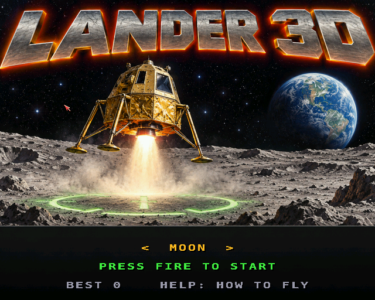
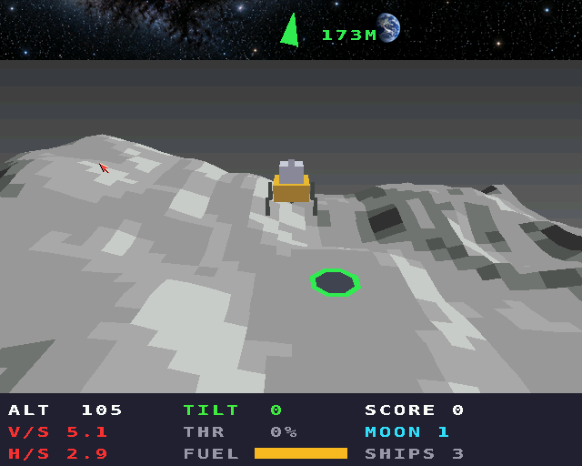
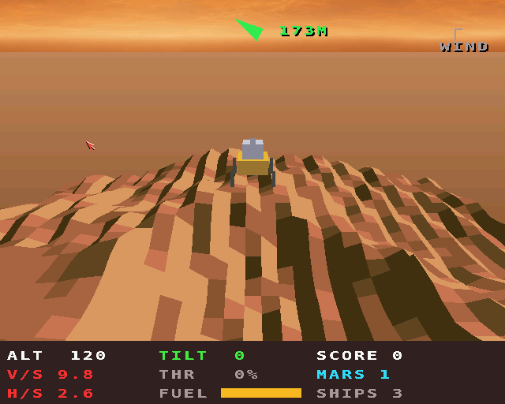
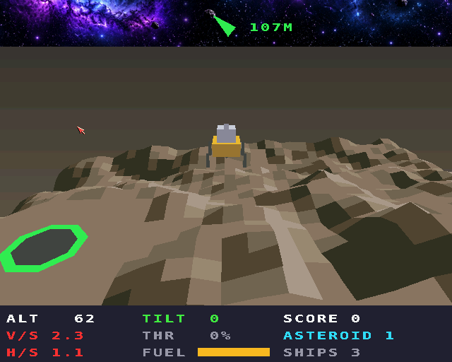
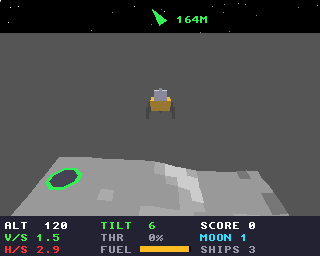

# Lander 3D

The lunar-lander idea in three dimensions, for the classic Amiga (68020
to 68060, OS 3.0+) and AmigaOS 4.1 (PowerPC). A port of the browser game
[Lander 3D](https://geekychris.github.io/tools/lander-3d/), on the shared
3D engine in [`../amiga3d`](../amiga3d/README.md).

You start high above generated terrain, moving, with a fixed amount of
fuel. The main engine pushes along the lander's own up direction: tip it
to move sideways, level it to stop, and keep enough thrust on to stop
gravity winning. Three pads are somewhere below: a big green one worth x1,
a yellow x2 and a small magenta x5 on rougher ground.

Touch down with every leg on a pad, falling no faster than the world's
limit (2.5 m/s on the Moon, 3 on Mars, 1.5 on the asteroid), sliding no
faster than 1.5, 1.8 or 1.0 m/s and tilted no more than 10 degrees (12 on
the asteroid). The HUD shows each reading green within its limit, amber
close to it and red past it; the arrow at the top points to the nearest
pad. A landing scores (100 + softness + fuel left) x the pad; a safe
landing off the pads scores 25; anything else costs a ship. **Moon**:
1.62 m/s2. **Mars**: 3.71 m/s2 and a gusting wind (shown top right).
**Asteroid**: hardly any gravity, a weak engine, rough ground. **Tour**
takes them in turn. Each level starts higher, faster and farther out,
with smaller pads.

| Key | Joystick | |
|---|---|---|
| Space / J | fire | full thrust |
| Q / E | | steady throttle down / up (10 % steps) |
| Up / W, down / S | up, down | tip forward, back |
| Left / A, right / D | left, right | tip left, right |
| P | | pause |
| Help / H | | the rules |
| Esc | | title / quit |

Attitude is assisted (it holds the angle when you let go), as the
browser's default.

## Screenshots

AmigaOS 4, with the painted title and skies:

| | |
|---|---|
|  |  |
|  |  |

The classic Amiga (32 colours, 320 x 256):



## How it works

- `ld_core.c` is the browser's `lander-3d-core.js` in 16.16 fixed point
  (a 68020 has no FPU): seeded terrain (value-noise fBm, craters with
  raised rims, Mars's dunes, the asteroid's curvature), pads placed on
  smooth or rough ground and flattened, the craft with its RCS, the wind,
  sub-stepped touchdown checks and the autopilot. The grid is 97 x 97
  (65 on the asteroid) rather than 129, for the renderer.
- Every level can be landed: the autopilot flies it once with plenty of
  fuel, and the tank gets 30 % more than that flight used. The browser does
  this before the level starts; here it runs in the background, a slice
  each frame, and tops the tank up if needed (a whole flight at once takes
  too long on a 68k).
- `render.c` draws a window of the height grid round the craft (its size
  is the `ground_win` variable), the pads, the lander tilted by its pitch
  and roll, its exhaust and shadow, and the HUD.
- On AmigaOS 4 the title starts with a painting (`assets/title_source.png`,
  made into `lander_title.img`), in turn with the demo, and each world
  has a painted sky (`assets/sky_<world>.png`, into `sky_<world>.img`):
  a panorama with its ends joined, its bottom edge on the horizon,
  drifting as you fly across. The ground is drawn 20 cells out rather than
  9, the map carried on past its edges as its mirror image, and the plain
  beyond fades into the distance. `make -C examples/lander_3d art` makes
  the pictures; the game loads them from beside itself.

## 68k notes

Two things only the 68k showed, found by diffing `lander_3d_trace` /
`make host-trace` runs on the Amiga against the host:

- The 68060 doesn't have the 64-bit multiply and divide that a 68020 does;
  `68060.library` emulates them, thousands of times slower. The shared
  engine builds with `-m68020-60`, which avoids them.
- GCC 6.5 for m68k miscompiled the 64-bit square roots at `-O2` (they came
  out 0, and a later division by zero crashed). The square roots and
  lengths are 32-bit now.

## Building and testing

```sh
scripts/build-example-68k.sh lander_3d       # lander_3d, lander_3d_test
scripts/build-example-ppc.sh lander_3d       # lander_3d_os4
make -C examples/lander_3d host-test         # 49 tests on the host
python3 examples/lander_3d/tests/e2e_devbench.py [--url ... --remote HOST]
python3 examples/lander_3d/tests/e2e_devbench.py --os4 HOST --url http://localhost:13002/mcp
```

The tests check the maths, the terrain and pads, the physics, the
touchdown rules and that the autopilot lands every world; they run on the
host, on the Amiga and inside the game (`selftest`). The end-to-end test
flies with injected keys, lands with the autopilot, crashes from 60 m,
visits every world and checks the help, through devbench; it passes on
FS-UAE (68060) and on QEMU's AmigaOS 4.

Music: `lander_3d.mod` ("Quiet Descent", `tools/modgen/lander_3d.py`).

## Driving it from devbench

Variables: `score ships level world state outcome agl vs hs tilt fuel
throttle x y z pad_dist autopilot probe_used menu paused help fps polys
us_update us_draw ground_win` (speeds in cm/s). Hooks: `status`, `start
moon|mars|asteroid|tour [level]`, `title`, `autopilot on|off`, `place
pad|high|offpad`, `help 0-2`, `pause on|off`, `activate`, `selftest`.
