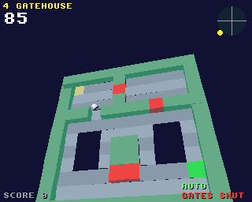
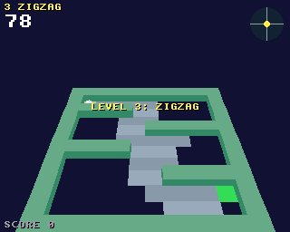

# Marble Tilt

Tilt a floating maze board to roll a marble to the exit, for the classic
Amiga (68020 to 68060, OS 3.0+) and AmigaOS 4.1 on PowerPC, from one
source on the shared [`amiga3d`](../amiga3d/README.md) engine.

The marble keeps rolling, so you tilt back to slow it. Eight levels mix
holes, gates that open and shut, bumpers, sand and checkpoints, each
against the clock.




## The game

- 8 levels: First Roll, The Moat, Zigzag, Gatehouse, Pinball, Sand Trap,
  Tightrope and The Gauntlet.
- Holes: fall in and you lose three seconds and start again from the last
  checkpoint (the blue squares).
- Gates (red blocks) are open for three seconds, then shut for three;
  shut, they are walls. A gate never shuts on the marble.
- Bumpers kick the marble away; sand drags it.
- The tilt eases over in a fifth of a second. The board is drawn at twice
  its tilt so a few degrees read, and the gauge at the top right shows it.
- Scoring: 100 x the level for each one done, and 10 for each second left.
- An autopilot (B) rolls on its own; it also plays behind the title.

## Controls

| | |
|---|---|
| Arrows / WASD / joystick | tilt |
| Up | the marble rolls away from you |
| Down | it rolls towards you |
| P | pause |
| B | autopilot on / off |
| Help / H | the rules and controls |
| Esc | back to the title, or quit from it |

On the title, up/down (or left/right) choose the level to start on.

## Building

```sh
scripts/build-example-68k.sh marble_tilt   # marble_tilt, marble_tilt_test
scripts/build-example-ppc.sh marble_tilt   # marble_tilt_os4
make -C examples/marble_tilt host-test     # the tests on the host
make -C examples/marble_tilt ubsan         # the same under UBSan and ASan
make -C examples/marble_tilt vectors       # regenerate tests/vectors.h
```

No data files: the levels are in the code, the effects are synthesised
at start-up and there is no music, so the binary is all you need.

## How it works

- `mt.h`, `mt_core.c`: the rules in 16.16 fixed point, with no Amiga
  headers. The levels are 12 x 12 text grids in `mt_core.c`; adding one is
  adding 12 strings and a name. The marble moves a quarter of a tick at a
  time against the walls round it: it is pushed out of the nearest point
  of a wall's square and bounces back at 40%. Bumpers are circles that
  reflect it and add a kick.
- The autopilot finds the shortest route to the exit across the grid
  (breadth-first, round walls, holes and bumpers). It aims through the
  next cells, waits short of a shut gate, and tilts to bring the marble's
  speed to a target, slower beside holes.
- `render.c`: the board rolled and pitched about its middle. Its floor is
  drawn a row at a time in runs of the same kind of cell, and its walls
  as blocks in runs too, so a level is about 90 polygons. The marble has a
  shadow, and drops away through a hole when it falls.
- `game.c`: input, sound, the title, game over and the bridge.

## Testing

`tests/test_cases.c` runs on the host, as `marble_tilt_test` on the
Amiga, and inside the game (the `selftest` hook). It checks every level
(its shape, start, exit and a route between), the tilt, rolling and
slowing, bouncing off walls (and never ending up inside one), falling and
coming back to a checkpoint, checkpoints, bumpers, gates (shutting,
blocking, reopening, never shutting on the marble), sand, the exit, the
level flow and the clock. It also checks that the autopilot rolls every
level without a fall. Finally it plays the whole game on the autopilot
and checks the state hash against the host's (`tests/vectors.h`), so the
Amiga must play exactly the same game.

`tests/e2e_devbench.py` drives the running game through devbench: the
self-test, the title, tilting with injected keys, a fall through a hole
and back, the exit, the autopilot through the Gatehouse, the board memory
region, running out of time, the help pages, timings and stopping.

```sh
python3 tests/e2e_devbench.py --url http://localhost:3001/mcp           # classic Amiga (builds and deploys)
python3 tests/e2e_devbench.py --os4 local --url http://localhost:3000/mcp --launch RAM:marble_tilt
```

Results on 2026-10-30: 27/27 host tests (also under UBSan and ASan);
22/22 end-to-end on FS-UAE (an A1200's 68020: 25 fps, about 23 ms to draw
a frame) and on AmigaOS 4.1 under QEMU (25 fps, about 1 ms a frame).

## Bridge

- vars (26): `score level time_s falls bumps state over won autoplay x z
  vx vz roll pitch gates falling row col start_level paused help fps polys
  us_update us_draw`
- hooks: `status`, `start [level]`, `title`, `autoplay on|off`,
  `put ROW COL`, `time S`, `help N`, `pause on|off`, `selftest`, `activate`
- memory: `board` (144 bytes: the cells, row 0 the far edge)
