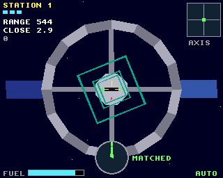
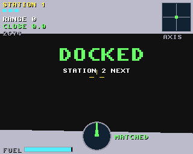

# Orbit Docking

A slow, tense docking simulator, for the classic Amiga (68020 to 68060,
OS 3.0+) and AmigaOS 4.1 on PowerPC, from one source on the shared
[`amiga3d`](../amiga3d/README.md) engine.

A station spins about its long axis. Its docking port is a slot at the
end of its hub, on that axis, turning with it. Fly your craft in along
the axis, roll to match the slot and turn as fast as it turns, and close
in gently. There is no friction in space: a push lasts until you push
back, and fuel is limited.




## The game

- At contact the craft must be within 14 units of the axis, closing at
  under 1.6 a tick, drifting across at under 0.8, rolled within 8 degrees
  of the slot (it looks the same turned half round), and turning within
  7 degrees a second of it. Anything else is a crash, and the crash
  message says which limit you broke. Three crashes end the game.
- The view rolls with the craft. Rolled and turning with the slot, the
  station stands still in front of you. The thrusters across are the
  craft's own: right is always right in the view.
- 6 stations: from a slow spin with you on the axis, to a fast spin the
  other way with you well off the axis and three pieces of debris
  drifting across the approach.
- Instruments: range and closing rate (green or red near the port), the
  axis box (where you are against the axis), the dial (the slot's roll:
  the needle up is lined up, "MATCHED" when you turn with it), and fuel.
- Scoring: 1000 a dock, + 500 x the station, + 2 for each unit of fuel
  left, less a little for the time taken.
- An autopilot (B) docks on its own; it also flies behind the title.

## Controls

| | |
|---|---|
| Cursor keys | move across (the craft's left, right, up, down) |
| W / S | forward (in) / back (out) |
| A / D | roll |
| Joystick | move across; with fire held: up/down in and out, left/right roll |
| P | pause |
| B | autopilot on / off |
| Help / H | the rules and controls |
| Esc | back to the title, or quit from it |

## Building

```sh
scripts/build-example-68k.sh orbit_docking   # orbit_docking, orbit_docking_test
scripts/build-example-ppc.sh orbit_docking   # orbit_docking_os4
make -C examples/orbit_docking host-test     # the tests on the host
make -C examples/orbit_docking ubsan         # the same under UBSan and ASan
make -C examples/orbit_docking vectors       # regenerate tests/vectors.h
```

No data files: the effects are synthesised at start-up and there is no
music, so the binary is all you need.

## How it works

- `od.h`, `od_core.c`: the rules in fixed point, with no Amiga headers.
  Angles are 16-bit with 8 more bits of fraction, so the slow spins
  accumulate exactly. The thrust across is turned from the craft's frame
  into the station's by the roll.
- The autopilot steers across towards the axis, wanting a speed
  proportional to the distance, turned into the craft's own right and up.
  It rolls onto the slot with a turn rate matched to the station's, and
  closes in only once lined up, slowing as it nears the port. Before a
  debris slice it works out, from its own speed and thrust, when it will
  be in that slice. It goes through only if the debris will be clear for
  the whole crossing; otherwise it waits short of the slice, or backs out.
- `render.c`: the camera with roll (**a proposed engine addition**: a3d's
  `Cam` has yaw and pitch; `cam_roll` turns camera space's x and y about
  the line of sight after `cam_xform`, and the stars turn with it). The
  station (hub, slot and lights, arms, ring, solar panels) turns about
  its axis; the approach markers and debris don't.
- `game.c`: input (the joystick uses fire as a shift), sound, the title,
  game over and the bridge.

## Testing

`tests/test_cases.c` runs on the host, as `orbit_docking_test` on the
Amiga, and inside the game (the `selftest` hook). It covers the stations,
thrusters in free space (and in the craft's rolled frame), fuel, the
slot's half-turn symmetry, a clean dock, every kind of crash (off the
axis, too fast, drifting, rolled wrong, not turning with it, the hub's
side, debris, drifting away), lives and the level flow. It also checks
the autopilot docking at stations 1 (three seeds), 3 and 4. Finally it
flies a long autopilot game and checks the state hash against the host's
(`tests/vectors.h`), so the Amiga must fly exactly the same game.

`tests/e2e_devbench.py` drives the running game through devbench: the
self-test, the title, thrusters and roll with injected keys, a gentle
dock and a crash from coming in too fast (lined up by the `lineup` hook,
then flown with keys), the autopilot docking, game over, the help pages,
timings and stopping.

```sh
python3 tests/e2e_devbench.py --url http://localhost:3001/mcp           # classic Amiga (builds and deploys)
python3 tests/e2e_devbench.py --os4 local --url http://localhost:3000/mcp --launch RAM:orbit_docking
```

Results on 2026-10-30: 33/33 host tests (also under UBSan and ASan);
23/23 end-to-end on FS-UAE (an A1200's 68020: 25 fps, about 22 ms to draw
a frame) and 22/22 on AmigaOS 4.1 under QEMU (25 fps, 2.4 ms a frame).

On the host the autopilot docks at stations 1 to 5 on all of 10 seeds,
with three debris crashes on its way at station 5. At station 6 it docks
on 6 of 10.

## Bridge

- vars (26): `score level lives fuel range close x y vx vy roll_err
  spin_err docks crashes fail state over won autoplay start_level paused
  help fps polys us_update us_draw`
- hooks: `status`, `start [station]`, `title`, `autoplay on|off`,
  `lineup [DIST]`, `fuel N`, `lives N`, `help N`, `pause on|off`,
  `selftest`, `activate`
