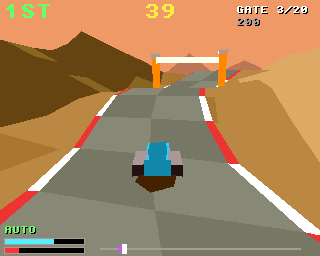
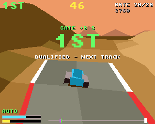

# Ridge Runner

A hover-bike race down a winding valley, for the classic Amiga (68020 to
68060, OS 3.0+) and AmigaOS 4.1 on PowerPC, from one source on the shared
[`amiga3d`](../amiga3d/README.md) engine.

Race three rivals down a valley track over rolling hills, with bumps that
throw the bike into the air over their crests. Pass between each gate's
pylons to add time to the clock, and finish in the first three to go on
to the next track.




## The game

- 6 tracks: Green Valley, Red Canyon, Dune Run, Frost Pass, Basalt Gorge
  and Sky Ridge, in three looks (grass, desert, snow). Each is twistier and
  hillier than the last, and the rivals are a little quicker on each.
- 20 gates, 800 units apart. Each one made adds time (9 seconds on the
  first track, 6 on the last); each one missed costs 3 seconds.
- Off the track the rough shoulder holds the bike to 60% of its speed;
  beyond that the valley's sides rise steeply.
- Over a crest the bike flies. You can hardly steer in the air, and a
  hard landing costs speed.
- The boost (the yellow bar) lasts about three seconds and recharges.
  Once it is empty it needs a fifth of a charge before it fires again.
- Bumping a rival slows you and pushes you aside. Hills slow the rivals
  just as they slow you, and they follow the course's bends.
- Scoring: 100 a gate; 3000, 2000 or 1000 for finishing 1st, 2nd or 3rd;
  and 10 for each second left on the clock.
- An autopilot (B) races on its own; it also races behind the title.

## Controls

| | |
|---|---|
| Left / right (A / D, joystick) | steer |
| Up (W, joystick up) | throttle |
| Down (S, joystick down) | brake |
| Space / fire, or Shift | boost |
| P | pause |
| B | autopilot on / off |
| Help / H | the rules and controls |
| Esc | back to the title, or quit from it |

## Building

```sh
scripts/build-example-68k.sh ridge_runner   # ridge_runner, ridge_runner_test
scripts/build-example-ppc.sh ridge_runner   # ridge_runner_os4
make -C examples/ridge_runner host-test     # the tests on the host
make -C examples/ridge_runner ubsan         # the same under UBSan and ASan
make -C examples/ridge_runner vectors       # regenerate tests/vectors.h
```

No data files: the effects are synthesised at start-up and there is no
music, so the binary is all you need.

## How it works

- `rr.h`, `rr_core.c`: the rules, in fixed point, with no Amiga headers.
  The ground is a sum of waves; the course's middle is two more. The bike
  hovers 14 units over the ground. When the ground falls away faster than
  gravity can follow, the bike flies.
- `render.c`: a window of the height grid around and ahead of the bike,
  each cell shaded by its slope (4 cells each side on the classic Amiga,
  12 on AmigaOS 4; the `ground_win` variable changes it live). The track is
  a ribbon laid over the ground, with kerbs. Then come the gates, the bikes
  (models, leaning into turns, with flames when boosting) and their
  shadows. The chase camera's heading eases after the bike's.
- `game.c`: input, the countdown, sound, the title, game over and the
  bridge.

## Testing

`tests/test_cases.c` runs on the host, as `ridge_runner_test` on the
Amiga, and inside the game (the `selftest` hook). It covers the ground and
course, throttle, brake and boost (including the boost not flickering when
empty), steering, rough ground, hovering and jumps, gates made and missed,
bumping a rival, the clock, the finish and places, qualifying and the
track flow. It also checks the autopilot winning track 1 (three seeds) and
qualifying on track 4. Finally it plays a long autopilot race and checks
the state hash against the host's (`tests/vectors.h`), so the Amiga must
race exactly the same race.

`tests/e2e_devbench.py` drives the running game through devbench: the
self-test, the title, the countdown, throttle, steering and boost with
injected keys, gates and jumps on the autopilot, finishing and qualifying,
running out of time, the help pages, timings and stopping.

```sh
python3 tests/e2e_devbench.py --url http://localhost:3001/mcp           # classic Amiga (builds and deploys)
python3 tests/e2e_devbench.py --os4 local --url http://localhost:3000/mcp --launch RAM:ridge_runner
```

Results on 2026-10-30: 35/35 host tests (also under UBSan and ASan);
24/24 end-to-end on FS-UAE (an A1200's 68020: 20 to 25 fps on track 6,
31 to 38 ms to draw a frame) and on AmigaOS 4.1 under QEMU (25 fps, 7 to
9 ms a frame with the 12-cell window).

On the host the autopilot wins tracks 1 to 3 on all of 10 seeds and track
4 on 8. On track 5 it finishes 1st once, 2nd six times and 3rd three
times. On track 6 it qualifies 3 times in 10.

## Bridge

- vars (29; the bridge takes 32 a client): `score track place gate
  gates_hit missed jumps state over won finished qualified autoplay x z
  speed energy boosting offtrack time_s countdown start_track ground_win
  paused help fps polys us_update us_draw`
- hooks: `status`, `start [track] [now]`, `title`, `autoplay on|off`,
  `warp Z`, `skip`, `time S`, `seed N`, `help N`, `pause on|off`,
  `selftest`, `activate`
