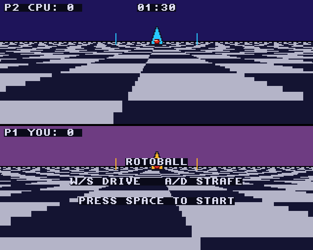
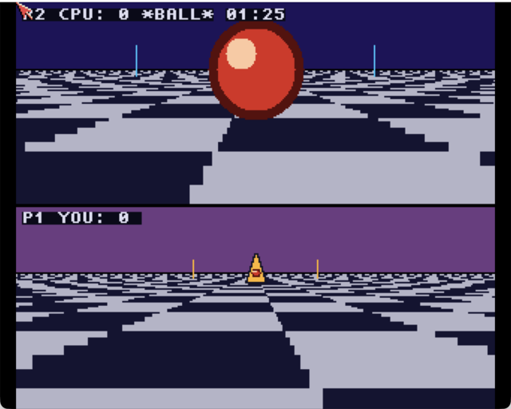
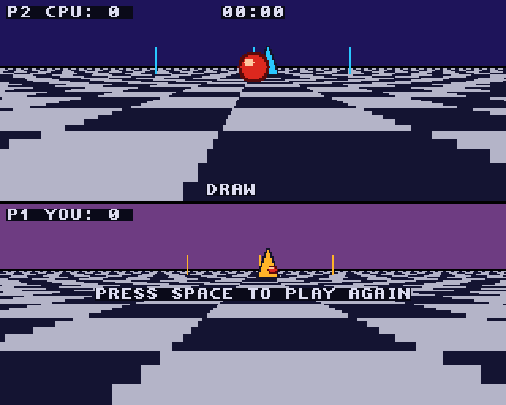

<!-- SPDX-License-Identifier: MIT -->
<!-- Copyright (c) 2026 Chris Collins <chris@hitorro.com> -->

# Rotoball

A split-screen futuristic ball sport for the classic Amiga (68020, OCS/ECS,
32 colours) and AmigaOS 4.1. You and the computer each pilot a hovering
skimmer over a chequered pitch: grab the ball and carry it over the other
goal line before the 90 seconds run out. The top half of the screen is the
computer's view, the bottom half yours. A goal scores 1, 2 or 3 points,
depending on how far out the run started.

| | |
|---|---|
|  |  |
| Kick-off screen | Playing |
|  | |
| Full time | |

68k build on FS-UAE (AmiKit).

## Controls

| Key | |
|---|---|
| W / S | drive forward / back |
| A / D | strafe left / right |
| Space | start the match (kick-off screen), play again (full time) |
| Esc | quit |

## Match flow

The game opens on a kick-off screen, with the pitch frozen, the title and
the controls; Space starts the match. At full time play freezes under the
result ("YOU WIN!", "CPU WINS" or "DRAW") and Space starts the next match.

## Build

```sh
make                                  # 68k, in Docker: amigadev/crosstools:m68k-amigaos
scripts/build-example-ppc.sh rotoball # AmigaOS 4 (rotoball_os4), from the repo root
```

## Fixes (October 2026)

Found while porting the game to the Atari Falcon and checking the 3DO port;
the [Falcon](https://github.com/geekychris/atari_st_games/tree/main/rotoball)
and [3DO](https://github.com/geekychris/3do-dev/tree/main/projects/rotoball)
versions have the same changes.

- **Match clock.** It counted drawn frames at an assumed 25 a second, but
  the loop runs one frame per `WaitTOF()`, up to 50 a second, so the
  "90 seconds" could be over in 45. The clock now counts real time
  (`CurrentTime()`, in 1/50 s units); the game itself still steps once per
  drawn frame, so it plays as before.
- **Full time.** The skimmers kept moving and goals kept counting under the
  result banner. Play now freezes at full time.
- **Start and restart.** The match used to start at launch and there was no
  way to play again short of restarting the program. There is now a
  kick-off screen and Space plays again after full time.
- **Tackles.** Two skimmers that stayed in contact passed the ball back and
  forth every time the tackle cooldown ran out (60 frames). Now a tackle
  also locks the ball to its new holder until the skimmers have separated:
  to win it back you have to come in again.
- `rotoball.h` described +Z as P1's right; it is P1's left (D strafes
  towards -Z, which the renderer draws to the right). Five
  `if (..) ..; if (..) ..;` lines (three in `main.c`, two in `pitch.c`)
  that GCC's `-Wmisleading-indentation` flagged are split, and `sound.c` includes `<clib/alib_protos.h>` for
  `BeginIO()`.
