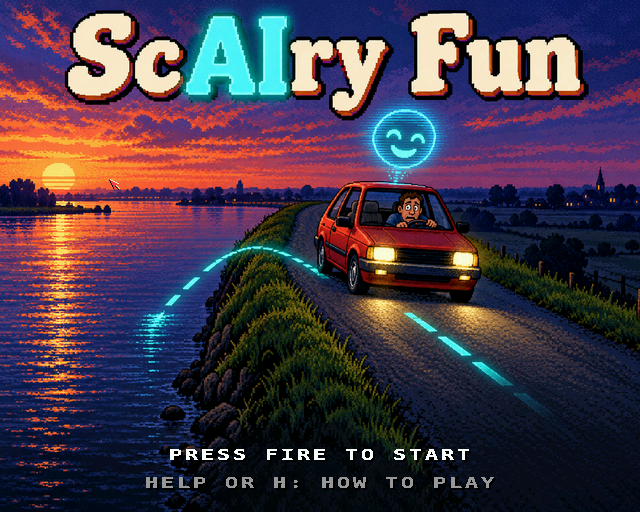
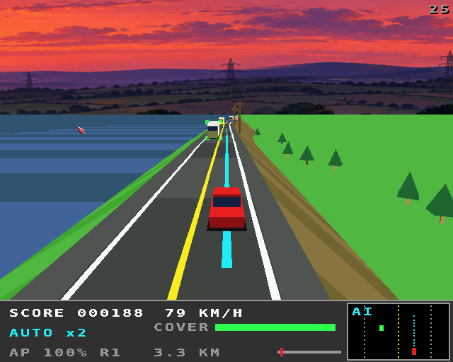
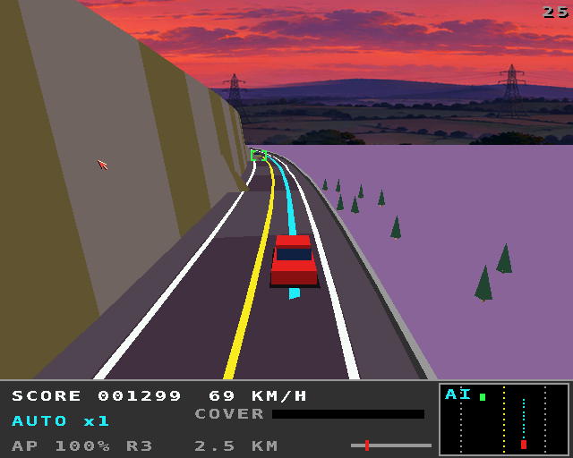
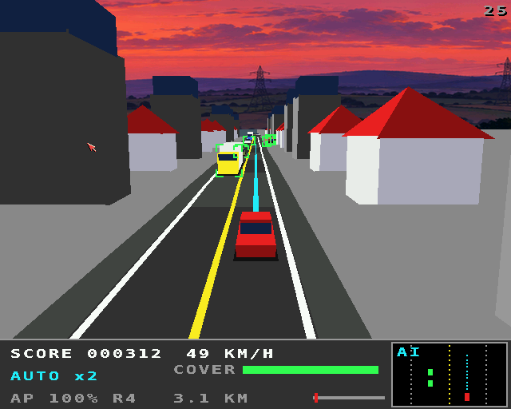
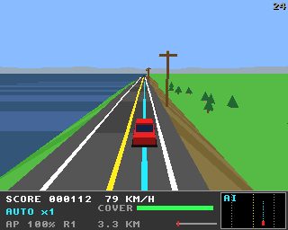

# ScAIry Fun

A self-driving car game for the classic Amiga (68020+, OS 3.0+, AGA or
ECS) and AmigaOS 4.1 (PowerPC), written with Claude Code against Amiga
DevBench, on the shared engine in [`../amiga3d`](../amiga3d/README.md).

You ride in a car that drives itself. Points come from the distance it
drives **on autopilot**, multiplied by how long it has stayed on (up to
x8). The autopilot is good, but it has blind spots, and the game is
learning them: take the wheel just before it gets something wrong, then
hand it back. Take over when it was right all along and it tells you
"I had that." See [DESIGN.md](DESIGN.md) for the whole design.

| Key | |
|---|---|
| Left / right | steer (takes over) |
| Down | brake (takes over) |
| Up | accelerate (when driving yourself) |
| Space / fire | autopilot on / off (on only near a lane centre) |
| Help / H | the rules (three pages; the title shows them too) |
| V | chase / cockpit view |
| P | pause |
| Return / F1 | start |
| Esc | title / quit |

## Screenshots

AmigaOS 4, with the painted title and the dusk all the way round:

| | |
|---|---|
|  |  |
|  |  |

The classic Amiga (32 colours, 320 x 256):



## The routes

| # | Route | Autopilot | It gets these wrong | It gets these right |
|---|---|---|---|---|
| 1 | Levee Road, to the marina | v1.0 | flooded road (it aquaplanes into the river), old lane lines over the embankment | cyclist, deer, a slow tractor |
| 2 | Rush Hour, to the office | v2.0 "now detects water" | overpass shadows (it brakes hard, the truck behind doesn't), coned-off lane, ambulance, debris | merging truck |
| 3 | Mountain Pass, to the ski lodge | v3.0 "phantom braking fixed" | low sun on the bends (the camera is blinded), fallen rocks, old lane lines | goats |
| 4 | Flooded Town, home | v4.0 "now confident" | flooded streets, a detour through the oncoming lane, an ambulance, a phantom shadow | pedestrians |

There are no warnings: you read the road (water on it, two sets of lane
lines, an overpass, cones, the sun) and the autopilot itself. Its planned
path is the cyan ribbon on the road, green brackets mark what it has
detected (red ones what it imagines), and the box at the bottom right is
its view from above. Taking over before a hazard it would get wrong, and
getting through, is a **good catch** (+500).

Damage comes off your insurance **cover** (100 at the start, +30 at each
destination): 2 per cone, 5 to 10 for a guardrail, barrier or rock wall,
10 for debris or an ambulance ticket, 15 when the truck behind runs into
you, 25 to 35 for a crash, 40 for the river or the embankment (the tow
truck puts you back with the autopilot off). At 0 the policy is cancelled.
Each destination adds a bonus of autopilot % x 50 + good catches x 500,
and the car installs a software update before the next route.

## How it works

- **Road**: each route is 8 m segments built from sections (bends, hills,
  what lies beside the road: levee and river, embankment, rock wall,
  cliff, median, town, canal). The car is aligned with the road, as in
  OutRun: steering moves it across, and bends push it outwards in
  proportion to speed squared.
- **Renderer** (`render.c`): the segments are drawn far to near, each with
  a cross-section of 8 points, so a painter's algorithm by segment gets
  hills and bends right without a depth sort; then lines, guardrails, the
  autopilot's path, cones, scenery and the models on that segment. It
  draws with the shared engine's 2D calls: on the classic Amiga the CPU
  fills spans straight into the five bitplanes and the blitter clears the
  sky and ground; on AmigaOS 4 everything is drawn at twice the resolution
  in full colour, with a smoother font. The sky gradient is the copper's
  on the classic Amiga, smooth on AmigaOS 4, and the low sun washes the
  palette out towards white.
- **Simulation** (`world.c`, `track.c`, and the engine's `a3d_math.c`):
  fixed 25 Hz, integer only, no Amiga headers, so the same code is tested
  on the host, on the Amiga and inside the game.
- **Display**: 320x256 PAL lores, 32 colours per route, double-buffered,
  25 fps on the classic Amiga; a 640x512 full-colour window or screen on
  AmigaOS 4 (F or F10 switches), where the title shows the painted
  artwork (`assets/title_source.png`, made into `scairy_title.img`) and
  a painted dusk all the way round (`assets/horizon.png`, into
  `scairy_horizon.img`) stands in for the routes' skylines, turning with
  the road.
- **Sound**: `scairy.mod` ("Autopilot Lounge", from
  `tools/modgen/scairy_fun.py`) on two channels; effects are synthesised
  at start-up; the AI's 19 lines (`scairy.voc`, from
  `tools/modgen/scairy_voices.py`: Kokoro TTS, voice bf_emma). ptplayer
  and Paula on the classic Amiga, AHI on AmigaOS 4.

## Building and running

```sh
scripts/build-example-68k.sh scairy_fun     # scairy_fun, scairy_fun_test (from the amiga_mcp checkout)
scripts/build-example-ppc.sh scairy_fun     # scairy_fun_os4
make -C examples/scairy_fun host-test       # 90 tests on the host
make -C examples/scairy_fun art             # scairy_title.img, scairy_horizon.img: AmigaOS 4's pictures
python3 examples/scairy_fun/tests/e2e_devbench.py   # on a live Amiga, through devbench
python3 examples/scairy_fun/tests/e2e_devbench.py --os4 HOST --url http://localhost:13002/mcp
```

The program needs `scairy.mod` and `scairy.voc` beside it (it runs
without them, silently), and on AmigaOS 4 `scairy_title.img` and
`scairy_horizon.img` for the painted title and sky. `make music` and `make voice` regenerate them.

## Testing

- `tests/test_cases.c`: 90 checks. Maths and the routes, the perfect
  autopilot driving every route start to finish in traffic, scoring and
  the multiplier, every hazard left to the autopilot (it must fail) and
  taken over (a save), and the bait (taking over is needless). They run
  on the host (`make host-test`), on the Amiga (`scairy_fun_test`) and
  inside the game (the `selftest` hook).
- `tests/trace_main.c`: `scairy_fun_trace` / `make host-trace` drive a
  route and print every event; diffing the Amiga's trace against the
  host's is how a 68k-only divergence was found (the m68k GCC mishandled
  `int8_t` lane fields; they're `int` now).
- `tests/e2e_devbench.py`: the whole game on a live Amiga through devbench
  MCP: build, deploy and launch; the self-test hook; key injection to
  start, take over, hand back and switch views; each hazard set up with
  the `scene` hook and checked in the remote log; a takeover judged a save
  by driving through the flood by hand; live tuning; the memory regions;
  the voice (on Paula, or logged on AmigaOS 4); the arrival, update and
  game-over screens; and screenshots of each. It passes on FS-UAE (68060)
  and QEMU's AmigaOS 4.

## Driving it from devbench

Variables: `score cover mult ap ap_pct kmh seg lane_d route state view
cstate saves needless takeovers hazard_next glare nseen fps polys
us_build us_draw us_hud in_keys in_joy` and the tunables `god_mode
ai_perfect traffic_pct speed_pct mult_secs aqua_kmh draw_dist`.

Hooks: `status`, `start`, `route <1-4>`, `scene <flood|ghost|phantom|
cones|glare|siren|debris|deer|cyclist|tractor|merge|goats|peds|finish>`,
`ap <on|off>`, `view <chase|cockpit>`, `say <1-19>`, `spawn <car|truck|
deer|debris|cyclist|goat|ped|tractor> [segments]`, `skip`, `title`,
`pause`, `help`, `selftest`, `activate`.

Memory regions: `route` (the segments), `plan` (the autopilot's 16
planned offsets), `seen` (what it has detected).

## Title artwork

`assets/chatgpt_prompt.md` is the prompt the main screen artwork
(`assets/title_source.png`) was made from. AmigaOS 4 shows it in full
colour at the start of the title; the classic Amiga's 32 colours draw the
logo over the autopilot demo instead.
