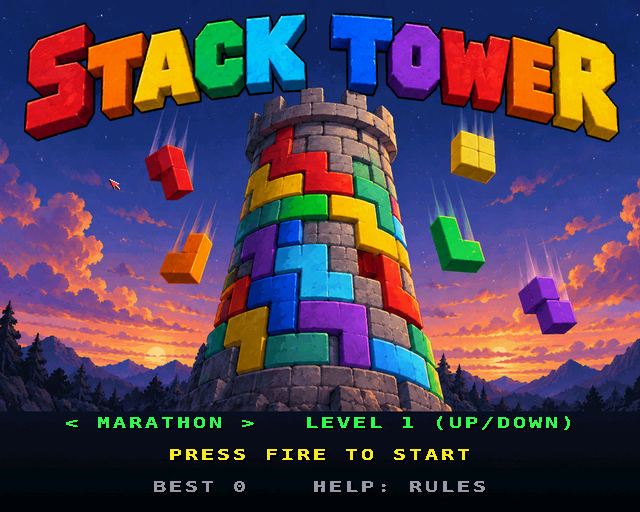
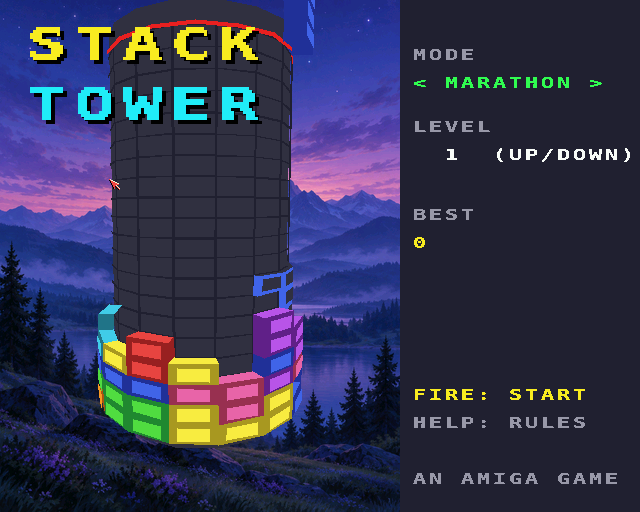
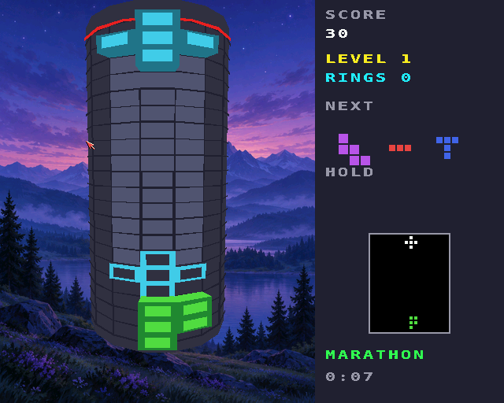
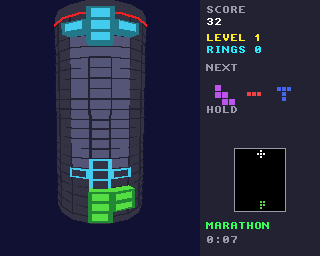

# Stack Tower

The falling-block puzzle wrapped round a tower, for the classic Amiga
(68020+, OS 3.0+) and AmigaOS 4.1 (PowerPC). A port of the browser game
[Stack tower](https://geekychris.github.io/tools/stack-tower/), on the
shared 3D engine in [`../amiga3d`](../amiga3d/README.md).

The well is sixteen columns that go all the way round, so there are no
side walls: a piece can hang over the seam, and a ring only clears when
the back of the tower is full too. Moving a piece left or right turns the
tower under it. The pieces are the browser game's own set of eight: a
three-square rod and elbow, and six five-square shapes (cup, flag, star,
anchor, stairs, bolt).

| Key | Joystick | |
|---|---|---|
| Left / right (A / D) | left / right | turn the tower (held: repeats) |
| Up / X | up | rotate clockwise |
| Z | | rotate anticlockwise |
| Down | down | soft drop |
| Space | fire | hard drop |
| C / left Shift | | hold |
| G | | ghost on / off |
| P | | pause |
| Help / H | | the rules |
| Esc | | title / quit |

On the title, left / right choose the mode and up / down the starting
level. **Marathon** speeds up every 10 rings; in **Rising** a ring of
rubble with a gap or two pushes up from below every few seconds; **Dig**
is ten rings of rubble to clear. Scoring is the browser's: 100, 300, 600,
1000, 1500 x level for one to five rings, a combo bonus for clearing on
piece after piece, 2 a row for a hard drop and 1 for a soft one.

## Screenshots

AmigaOS 4, with the painted title and backdrop:

| | |
|---|---|
|  |  |



The classic Amiga (32 colours, 320 x 256):



## How it works

- `st_core.c` is the browser's `stack-tower-core.js` in C, with the same
  random generator and piece bag, so a seed deals the same pieces. Times
  are whole milliseconds.
- `render.c` draws the tower with the shared engine: the core's panels
  and every block as a brick sticking out of it, culled and depth-sorted,
  the tower turning so the falling piece faces you. The panel shows the
  next three pieces, the held one and the whole tower unrolled.
- `game.c` is the shell: input, the title's demo game, sound, and the
  bridge interface.
- On AmigaOS 4 a painted twilight landscape (`assets/backdrop.png`, made
  into `stack_backdrop.img`) is behind the tower, and the title starts
  with a painting (`assets/title_source.png`, into `stack_title.img`),
  in turn with the demo. `make -C examples/stack_tower art` makes them;
  the game loads them from beside itself.

## Building and testing

```sh
scripts/build-example-68k.sh stack_tower     # stack_tower, stack_tower_test
scripts/build-example-ppc.sh stack_tower     # stack_tower_os4
make -C examples/stack_tower host-test       # 45 tests on the host
python3 examples/stack_tower/tests/e2e_devbench.py              # on a classic Amiga through devbench
python3 examples/stack_tower/tests/e2e_devbench.py --os4 HOST --url http://localhost:13002/mcp
```

The tests include four games played by the browser's own engine
(`tests/vectors.h`, from `tests/gen_vectors.js`: moves, turns, holds and
hard drops, so gravity's floating-point timing doesn't come into it); the
C port must end each with the same score, board, queue and held piece.
They run on the host, on the Amiga (`stack_tower_test`) and inside the
game (the `selftest` hook). The end-to-end test drives the game through
devbench: keys for the title, turning, rotating and dropping, hooks for
rubble and a game over, the board memory region, the help pages,
screenshots and timings. It passes on FS-UAE (68060) and on QEMU's
AmigaOS 4.

Music: `stack_tower.mod` ("Tower Climb", `tools/modgen/stack_tower.py`).

## Driving it from devbench

Variables: `score level lines state mode over won pieces col row ptype
hold garbage view ghost combo time_ms start_level paused help fps polys
us_update us_draw` (and `in_keys in_joy`). Hooks: `status`, `start
[marathon|rising|dig] [level]`, `title`, `move N`, `rotate 1|-1`, `drop`,
`hold`, `garbage [gaps]`, `seed N`, `help 0-2`, `pause on|off`,
`selftest`, `activate`. Memory: `board` (16 x 24 bytes, bottom row first).
