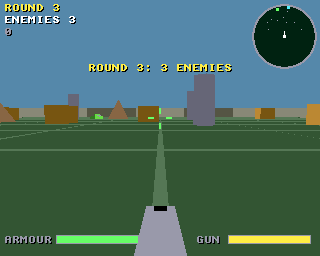
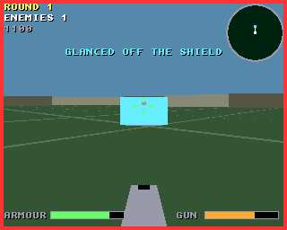

# Tank Duel

A tank fight in a walled arena, seen from the turret, for the classic
Amiga (68020 to 68060, OS 3.0+) and AmigaOS 4.1 on PowerPC, from one
source on the shared [`amiga3d`](../amiga3d/README.md) engine.

Destroy every enemy tank in the arena. Shells bounce once off the walls,
so you can bank a shot round cover, and crates break. Each enemy needs
different handling:

- **Scout**: quick and light. It circles you, then turns in to snipe.
- **Mortar**: slow. It lobs shells at where you are; a red ring on the
  ground shows where each will land, so get out of it.
- **Bulwark**: a heavy tank with a shield across its front, and shots
  there glance off (sometimes back at you). It turns slowly, so get
  round to its side.




## The game

- 8 rounds, from two scouts to six tanks with three bulwarks. Between
  rounds your tank is patched up by 30 armour points.
- Your armour is 100; a shell takes 20, and a mortar round up to 35 at
  the middle of its ring. Scouts take one hit, mortars and bulwarks two.
- The radar turns with you: ahead is up. Scouts show green, mortars
  orange, bulwarks cyan, and mortar rings red.
- Scoring: 100 a scout, 200 a mortar, 300 a bulwark, 20 a crate; 500 x
  the round for clearing it, and 5 for each point of armour left.
- An autopilot (B) fights on its own; it also fights behind the title.

## Controls

| | |
|---|---|
| Up / down (W / S, joystick) | forward / back |
| Left / right (A / D, joystick) | turn |
| Space / fire | fire |
| P | pause |
| B | autopilot on / off |
| Help / H | the rules and controls |
| Esc | back to the title, or quit from it |

## Building

```sh
scripts/build-example-68k.sh tank_duel   # tank_duel, tank_duel_test
scripts/build-example-ppc.sh tank_duel   # tank_duel_os4
make -C examples/tank_duel host-test     # the tests on the host
make -C examples/tank_duel ubsan         # the same under UBSan and ASan
make -C examples/tank_duel vectors       # regenerate tests/vectors.h
```

No data files: the effects are synthesised at start-up and there is no
music, so the binary is all you need.

## How it works

- `td.h`, `td_core.c`: the rules in 16.16 fixed point, with no Amiga
  headers. Tanks are circles pushed out of pillars, pyramids, crates
  (squares), the walls and each other. Shells move four steps a tick. The
  bulwark's shield covers 35 degrees each side of its heading, and it
  turns at 14 degrees a second.
- Each enemy's mind is a few lines: the scout orbits at 260 to 420 units
  and turns in to snipe every few seconds; the mortar keeps 450 to 750
  away and lobs at where you will be; the bulwark comes straight at you.
  All of them steer round anything ahead.
- The autopilot fights the nearest enemy. It circles a bulwark at 320 units
  until it is well off the shield, then stops, aims and fires. It also
  drives out of mortar rings.
- `render.c`: the floor with its grid, the walls, the cover and the tanks
  as models, shells, mortar rounds on their arcs with their rings, and
  explosions. The HUD has the gun, the sight, the armour and gun bars, and
  the radar.
- `game.c`: input, sound, the title, game over and the bridge.

## Testing

`tests/test_cases.c` runs on the host, as `tank_duel_test` on the Amiga,
and inside the game (the `selftest` hook). It covers the rounds'
line-ups, driving, the walls and cover, firing and reloading, kills, a
bank shot off a wall (and only one bounce), the bulwark's shield from the
front and from behind, crates, mortar rounds landing on you and missing
you when you drive off, dying, and the round flow. It also checks the
autopilot clearing rounds 1 (three seeds), 2 and 3. Finally it plays a
long autopilot fight and checks the state hash against the host's
(`tests/vectors.h`), so the Amiga must fight exactly the same fight.

`tests/e2e_devbench.py` drives the running game through devbench: the
self-test, the title, driving, turning and firing with injected keys, a
practice scout destroyed and a shot glancing off a practice bulwark (the
`spawn` hook), the autopilot clearing a round, being destroyed, the help
pages, timings and stopping.

```sh
python3 tests/e2e_devbench.py --url http://localhost:3001/mcp           # classic Amiga (builds and deploys)
python3 tests/e2e_devbench.py --os4 local --url http://localhost:3000/mcp --launch RAM:tank_duel
```

Results on 2026-10-30: 33/33 host tests (also under UBSan and ASan);
21/21 end-to-end on FS-UAE (an A1200's 68020: 25 fps, about 25 ms to draw
a frame) and 20/20 on AmigaOS 4.1 under QEMU (25 fps, about 1 ms a frame).

The autopilot is a fair fighter, not a perfect one. On the host it clears
round 1 and round 5 on all of 10 seeds and round 3 on 8. Against
bulwarks (rounds 2, 4, 6 to 8) it clears 2 to 6 of 10.

## Bridge

- vars (24): `score round enemies kills shots hits hp reload state over
  won autoplay x z yaw speed damage start_round paused help fps polys
  us_update us_draw`
- hooks: `status`, `start [round]`, `title`, `autoplay on|off`,
  `spawn scout|mortar|bulwark [DIST]` (a lone practice target that holds
  still), `clear`, `hp N`, `seed N`, `help N`, `pause on|off`, `selftest`,
  `activate`
